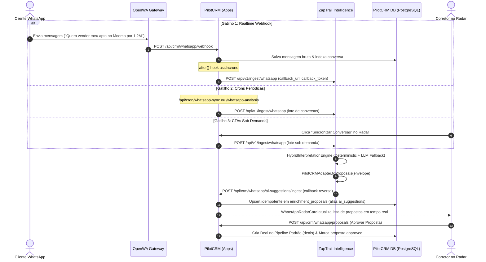

# Phase 08 Context: End-to-End Cross-Repo Integration & Verification

## 1. Executive Summary & Goal

A **Fase 08** representa o fechamento do **Milestone v1.1.0** (PilotCRM Native Integration & Marketplace). O objetivo central é fornecer uma **suíte de testes E2E automatizada e resiliente** que comprove, com rigor científico e determinístico, o funcionamento bidirecional do ZapTrail integrado ao PilotCRM, cobrindo:
1. Os 3 gatilhos de entrada do PilotCRM (webhook realtime, crons de background e CTAs sob demanda).
2. O ciclo completo de extração semântica e despacho de sugestões de IA (`ai_suggestions`).
3. Garantias absolutas de idempotência em alta concorrência (zero duplicatas de propostas ou negócios sob rajadas de mensagens).
4. O ciclo final de aprovação pelo corretor no Radar, resultando na criação de Deals no Kanban com todos os atributos extraídos preenchidos.

---

## 2. Architecture & Bidirectional Data Flow

---

## 3. Requirements & Scope Boundaries

### Requirement PCRM-08
> "Suíte de testes E2E simulando os 3 gatilhos, deduplicação de webhooks, geração de propostas e aprovação para criação de Deal no PilotCRM."

### Success Criteria (from ROADMAP.md)
1. **Cenários de ponta a ponta simulam os 3 gatilhos** e confirmam 100% de sucesso na ingestão no ZapTrail e retorno para o PilotCRM.
2. **Testes de estresse e deduplicação comprovam idempotência** com 0 duplicações de propostas ou mensagens mesmo sob rajadas concorrentes ou retentativas.
3. **Ciclo completo de aprovação de proposta na UI do PilotCRM** gera Deal com todas as propriedades extraídas preenchidas (título, valor, estágio, notas com bairro e intenção).

---

## 4. Key Constraints & Policies

1. **Line Ceiling**: Todos os arquivos de produção e teste devem cumprir rigorosamente as políticas de governança do monorepo ($\le 350$ linhas por arquivo de produção).
2. **ASVS Level 1 Security**:
   - Zero tokens em logs ou payloads de erro (`T-07-04`).
   - Autenticação por token Bearer vinculada ao tenant (`T-07-01`).
   - Timeout máximo de 8.000ms nos despachos HTTP (`T-07-03`).
   - Zero uso de `localStorage`.
3. **Zero Regressões**: A suíte existente de 236 testes no ZapTrail e 178 testes no PilotCRM deve permanecer 100% verde.
