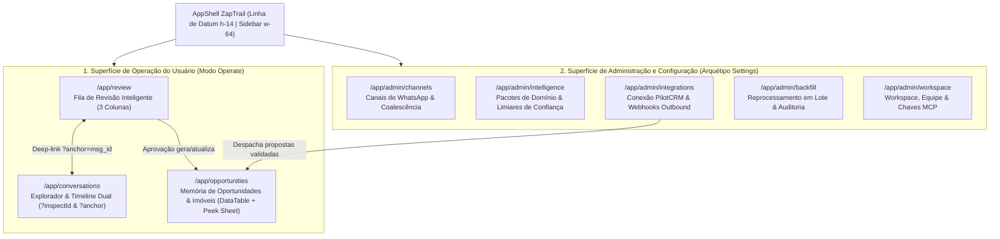

# ZapTrail — Especificação Canônica de UI/UX: Cockpit de Operação do Usuário e Console de Administração

> **Status:** Especificação Arquitetural e de Design System (`superpowers:brainstorming` + `impeccable`)  
> **Data:** 2026-11-04  
> **Alinhamento:** Design System Canônico PilotCRM (`@repo/ui`, Tokens OKLCH, Linha de Datum `h-14`, 6 Leis de UI/UX Writing, WCAG 2.2 AA)  
> **Público:** Corretores, SDRs, Operadores de Revisão Semântica e Administradores de Workspace

---

## 1. Visão Geral e Princípios Diretores

O **ZapTrail** transforma conversas coloquiais e fragmentadas de WhatsApp em objetos de negócio auditáveis (Oportunidades, Imóveis Candidatos, Tarefas, Compromissos, Decisões e Alertas) com evidência literal (`exact_quote` + offsets determinísticos `char_start`/`char_end`) e separação epistêmica estrita (`declared`, `inferred`, `validated_human`, `rejected`, `superseded`).

Para que toda essa sofisticação semântica seja operada com esforço cognitivo mínimo, a interface do ZapTrail é regida por **três pilares fundamentais** e pelas **10 Heurísticas de Usabilidade de Jakob Nielsen**:

### 1.1. Os Três Pilares de Experiência

1. **Simplicidade Genial (Lean 80/20 & Zero Jargão Técnico):**
   - A complexidade algorítmica do pipeline híbrido (Coalescedor de Turnos, Classificador Determinístico de 7 Camadas, Validador Anti-Alucinação de Offsets e `PilotCRMAdapter`) permanece 100% invisível.
   - O usuário nunca vê termos internos de engenharia (`epistemic_status`, `char_start`, `turn_window`, `enrichment_action_ck`, `JSONB`, `RLS`).
   - Em cada item, o usuário enxerga apenas três elementos essenciais: **O que foi detectado** (fato ou oportunidade formatada), **Por que o sistema acredita nisso** (trecho exato grifado na conversa) e **O que fazer a seguir** (Aprovar, Editar ou Rejeitar em 1 clique).

2. **Inteligência Pragmática (Automação Silenciosa + Exceção Assistida):**
   - **Regra 80/20 de Atenção Humana:** Extrações determinísticas inequívocas com confiança $\ge 85\%$ (`auto_confirm`) seguem automaticamente para o PilotCRM sem interromper o operador.
   - A interface humana concentra 100% do foco nos casos onde o julgamento humano gera valor real: faixa de revisão ($65\% \text{ a } 84\%$), divergência de preço em relação ao histórico, múltiplos imóveis na mesma conversa (`Segundo Imóvel Detectado`), demandas condicionadas (`Compra Condicionada à Venda`) ou citações sinalizadas pelo guarda anti-alucinação.

3. **Navegação Contextual (*Zero Context-Stripping*):**
   - Inspirada nos 7 benchmarks globais do PilotCRM (**Linear, Attio, Folk, Superhuman, Stripe Dashboard, Supabase Studio e Raycast**).
   - **Preservação Espacial:** O operador nunca sofre redirecionamento destrutivo de página ao inspecionar uma conversa, evidência ou oportunidade. A inspeção ocorre em **Layout Master-Detail de 3 Colunas** ou via **Peek Sheet lateral (`Sheet side="right"`)** sincronizado na URL (`?inspectId=...` e `?anchor=msg_...`).
   - **Fluxo Contínuo por Teclado (*Inbox Zero*):** Travessia instantânea da fila com `j` / `k` (ou setas `↓` / `↑`), aprovação com `a`, edição rápida com `e`, rejeição com `r`, salto para a mensagem original com `m` e fechamento contextual com `Esc`.

---

## 2. Aplicação das 10 Heurísticas de Nielsen e Benchmarks Globais

| # | Heurística de Nielsen | Benchmark de Referência | Implementação Concreta no ZapTrail |
| :--- | :--- | :--- | :--- |
| **H1** | **Visibilidade do Status do Sistema** | Linear / Supabase Studio | Widget no `headerRight` exibe estado em tempo real do canal (`WhatsApp Verificado` vs. `Modo Simulação`), saúde do webhook PilotCRM e contador da Fila de Revisão. Cada tela implementa obrigatoriamente a **Máquina dos 5 Estados** (`Ideal`, `Loading Skeleton 1:1`, `EmptyState`, `FilteredEmptyState`, `ErrorState`). |
| **H2** | **Correspondência com o Mundo Real** | Folk / Attio | Tradução integral de estados epistêmicos e intenções para linguagem natural de negócios em `pt-BR`: `validated_human` $\rightarrow$ `Validado por Você`; `inferred` $\rightarrow$ `Sugestão da IA`; `CAPTURE_OTHER_PROPERTY` $\rightarrow$ `Segundo Imóvel na Conversa`; `do_not_contact` $\rightarrow$ `Opt-out Solicitado`. Valores monetários em `R$` e áreas em `m²` com fonte tabular `Geist Mono`. |
| **H3** | **Controle e Liberdade do Usuário** | Superhuman / Gmail | Toda decisão de revisão (`Aprovar`, `Editar`, `Rejeitar`) exibe notificação discreta com botão **`Desfazer`** ativo por 8 segundos. Edições humanas salvam os novos valores em `resolved_payload` preservando `original_payload` intacto para auditoria e reversão. |
| **H4** | **Consistência e Padrões** | PilotCRM (`@repo/ui`) | Geometria idêntica ao PilotCRM: **Linha de Datum contínua em `y = 56px` (`h-14`)**, Sidebar fixa `w-64`, tokens semânticos OKLCH, **Regra do Único Acento** ($\le 10\%$ de roxo operacional `--primary`), **Flat-by-Default** e cumprimento das **6 Leis de UI/UX Writing**. |
| **H5** | **Prevenção de Erros** | Stripe Dashboard | Ações externas irreversíveis são bloqueadas estruturalmente quando confiança $< 85\%$ ou quando `hallucination_detected = true`. Nas configurações de Admin, salvar um endpoint exige validação de URL e oferece botão `Testar Conexão` antes de habilitar o tráfego em produção. |
| **H6** | **Reconhecimento em vez de Memorização** | Attio / Linear | O card de revisão já traz embutido o contexto completo: (1) a pergunta outbound que originou o turno, (2) a resposta do cliente com o trecho exato grifado (`<mark>`) e (3) o valor anterior caso seja uma atualização de preço (ex.: `De R$ 1.250.000 para R$ 1.180.000`). |
| **H7** | **Flexibilidade e Eficiência de Uso** | Superhuman / Raycast | Atalhos de teclado de 1 tecla (`j`, `k`, `a`, `e`, `r`, `m`), Command Palette global (`⌘K`), filtros rápidos por severidade/tipo em 1 clique e aprovação em lote transparente (`Aprovar Selecionados (N)`). |
| **H8** | **Estética e Design Minimalista** | Vercel / Linear | Zero cards aninhados, zero gradientes decorativos, zero `border-l-4` colorido. Hierarquia construída exclusivamente com peso tipográfico (`Geist Sans`), dados tabulares (`Geist Mono`), superfícies tonais (`bg-background`, `bg-card`, `bg-muted`) e divisórias de `1px` (`border-border`). |
| **H9** | **Reconhecimento e Recuperação de Erros** | Stripe / Vercel | Estados de erro (`AsyncState` / `ErrorState` com `role="alert"`) explicam o problema em linguagem humana sem expor stack traces ou erros SQL, acompanhados sempre de ação direta (`Tentar Novamente`, `Reenviar Proposta`). |
| **H10** | **Ajuda e Documentação Contextual** | Stripe / Supabase | `InfoTip` ao lado de cada motivo de revisão explicando de forma concisa por que a IA solicitou validação humana, além de fluxo de **Onboarding Guiado** que permite testar os 20 Casos-Ouro em modo Simulação antes de plugar o provedor real. |

---

## 3. Design System e Governança Visual (Padrão PilotCRM)

### 3.1. Tokens Semânticos OKLCH (`tokens.css`)
O ZapTrail compartilha integralmente a paleta OKLCH e a tipografia do PilotCRM:
- **Superfícies Neutras:** `--background: oklch(0.96 0.002 285)`, `--card: oklch(1 0 0)`, `--muted: oklch(0.967 0.001 286.375)`, `--border: oklch(0.92 0.004 286.32)`.
- **Acento Único (*The One Accent Rule*):** `--primary: oklch(0.491 0.27 292.581)` (Deep Operate Purple, restrito a $\le 10\%$ da tela: CTAs primários, item ativo da fila e foco).
- **Semântica de Status e Confiança:**
  - Alta Confiança ($\ge 85\%$) / Aprovado: `--success: oklch(0.535 0.16 142.1)` (`bg-success/10 text-success border-success/20`).
  - Média Confiança ($65\%\text{–}84\%$) / Revisão Pendente: `--warning: oklch(0.555 0.15 66.29)` (`bg-warning/10 text-warning border-warning/20`).
  - Baixa Confiança ($< 65\%$) / Divergência Crítica / Rejeitado: `--destructive: oklch(0.577 0.245 27.325)` (`bg-destructive/10 text-destructive border-destructive/20`).
- **Categorias de Objetos (DS-71):**
  - `Oportunidade` (`opportunity`): `--category-proposal` (`oklch(0.55 0.24 310)`).
  - `Tarefa` (`task`): `--category-info` (`oklch(0.65 0.18 210)`).
  - `Compromisso` (`commitment`): `--category-visit` (`oklch(0.55 0.24 290)`).
  - `Decisão` (`decision`): `--category-negotiation` (`oklch(0.58 0.15 180)`).
  - `Alerta` (`alert`): `--warning` / `--destructive`.

### 3.2. Geometria do AppShell e Linha de Datum (`h-14` / `56px`)
- **Sidebar Desktop (`w-64` / `256px`):** Cabeçalho fixo `h-14 px-4 border-b border-border bg-card` com identidade ZapTrail e seletor de Workspace; navegação dividida em dois grupos claros: **Operação** (Fila de Revisão, Conversas, Oportunidades) e **Administração** (Canais de WhatsApp, Inteligência e Domínio, Integração PilotCRM, Reprocessamento, Workspace).
- **Header Principal (`h-14`):** Alinhado milimetricamente ao cabeçalho da Sidebar em `y = 56px` (`border-b border-border bg-card sticky top-0 z-20`).
  - `headerLeft`: Breadcrumbs contextuais + atalho `⌘K`.
  - `headerRight`: Badge de status do canal (`WhatsApp Verificado` ou `Simulação Ativa`), status de sincronia PilotCRM e perfil do operador.
- **Mobile Navigation (`< 1024px`):** Barra inferior fixa na *Thumb Zone* com 4 destinos essenciais (`Revisão`, `Conversas`, `Oportunidades`, `Ajustes`) e alvos de toque $\ge 44\times 44\text{px}$ (`min-h-11 min-w-11`).

### 3.3. As 6 Leis de UI/UX Writing em `pt-BR`
1. **CTAs de 1 a 2 palavras no Infinitivo:** `Aprovar Sugestão`, `Salvar Alterações`, `Rejeitar Item`, `Testar Conexão`, `Aprovar (5)`.
2. **Zero Advérbios Temporais em Botões:** Proibido usar *"Analisar Agora"* ou *"Sincronizar Já"* $\rightarrow$ usar `Analisar Conversa`, `Sincronizar Conversas`.
3. **Zero Barras (`/`) ou Ampersands (`&`) em Rótulos:** Proibido usar *"Regras & Limiares"* ou *"Aprovar / Rejeitar"* $\rightarrow$ usar `Regras de Confiança`, `Fila de Revisão`.
4. **Zero Jargão Técnico:** Proibido exibir `turn_window`, `epistemic_status`, `coalescer`, `payload`, `RLS`.
5. **Ações em Lote Transparentes:** Checkboxes individuais, botão `Limpar Seleção` e contador exato no CTA (`Aprovar (12)`).
6. **Erros Humanos e Acionáveis:** Sempre acompanhados do botão `Tentar Novamente`.

---

## 4. Arquitetura de Navegação e Mapa de Rotas

Respeitando a **Zero Silo Rule** do PilotCRM, o ZapTrail evita rotas fragmentadas ou redundantes, consolidando toda a experiência em **3 rotas de Operação do Usuário** e **1 console unificado de Administração com 5 seções**:



---

## 5. Desenho Detalhado — Superfície 1: UI de Operação pelo Usuário

### 5.1. Fila de Revisão Inteligente (`/app/review`) — O Coração Operacional

Projetada segundo o benchmark **Superhuman + Linear Triage + PilotCRM Inbox**, estruturada em **3 colunas simultâneas** no desktop (`w-full min-w-0 flex-1 grid grid-cols-1 lg:grid-cols-12`):

```
┌──────────────────────────────────────────────────────────────────────────────────────────┐
│ [h-14] Fila de Revisão (12 pendentes)          [⌘K Buscar] [🟢 WhatsApp Verificado] [👤] │
├────────────────────────┬───────────────────────────────────┬─────────────────────────────┤
│ COLUNA 1: FILA (3 col) │ COLUNA 2: CONVERSA ORIGINAL (5 c) │ COLUNA 3: DECISÃO (4 col)   │
│ [Buscar...] [Filtros]  │ Carlos Mendes • +55 11 99812-0011 │ SUGESTÃO DA IA • 78% Conf.  │
│ [ ] Selecionar (12)    │ ───────────────────────────────── │ ─────────────────────────── │
│ ┌────────────────────┐ │ [14:02] Você (Campanha Outbound): │ Tipo: Captação para Venda   │
│ │● Alta • 78%  14:04 │ │ "Olá Carlos, seu apto no Itaim    │ Papel: Proprietário         │
│ │Carlos Mendes       │ │  ainda está disponível?"          │ Imóvel: Apto 3 dorms Itaim  │
│ │Segundo Imóvel      │ │                                   │ Valor Pedido: R$ 1.850.000  │
│ │"O de 2 dorms..."   │ │ [14:04] Carlos Mendes:            │ Condomínio: R$ 2.100        │
│ └────────────────────┘ │ "Esse de 3 quartos eu já vendi,   │                             │
│ ┌────────────────────┐ │  mas tenho <mark>outro de 2 dorms │ Motivo da Revisão:          │
│ │○ Média • 72% 13:50 │ │  na Rua Joaquim Floriano por      │ Segundo imóvel ofertado na  │
│ │Mariana Costa       │ │  1,85 milhão</mark> se interessar"│ mesma conversa após recusa. │
│ │Compra Condicionada │ │                                   │                             │
│ └────────────────────┘ │ [Ir para conversa completa ↗]     │ [Aprovar Sugestão (A)]      │
│                        │                                   │ [Editar Dados (E)] [Rejeitar]│
└────────────────────────┴───────────────────────────────────┴─────────────────────────────┘
```

#### Componentes e Fluxos da Fila de Revisão:
1. **Coluna 1 — Lista Priorizada de Revisão (`ReviewQueueList`):**
   - Ordenação padrão por **Severidade** (`Alta` $\rightarrow$ `Média` $\rightarrow$ `Baixa`) e **Recência**.
   - Chips de filtro rápido em 1 clique: `Todos`, `Oportunidades`, `Imóveis`, `Tarefas`, `Alertas`.
   - Suporte a seleção múltipla com `BulkActionBar` flutuante: `Aprovar (N)` ou `Rejeitar (N)`.
2. **Coluna 2 — Conversa Original Sincronizada (`ConversationContextViewer`):**
   - Exibe a janela de turno (`TurnWindow`) completa: mensagem outbound de contexto + mensagens inbound coalescidas.
   - Renderiza o destaque exato de caracteres (`<mark className="bg-warning/20 text-foreground rounded px-1 font-medium">`) calculado deterministicamente por [`buildShowInConversationLink`](file:///c:/Users/Gustavo/Documents/antigravity/dazzling-goodall/src/packages/core/review-inbox.ts#L56-L122).
3. **Coluna 3 — Painel de Inspeção e Decisão (`ReviewDecisionPanel`):**
   - Exibe os atributos extraídos (Intenção, Papel do Interlocutor, Tipologia, Bairro, Valores em `Geist Mono`, Condicionantes).
   - **Comparador Antes $\rightarrow$ Depois:** Quando a proposta altera um valor existente (`UPDATE` / `CONTRADICT`), mostra lado a lado o valor anterior e o novo valor extraído.
   - **Modo de Edição In-Place (`Editar Dados`):** Permite corrigir qualquer campo (ex.: ajustar `R$ 1.850.000` ou o bairro) antes de aprovar. Ao salvar, grava `decision: "edit"`, preserva `original_payload` intacto e promove `epistemic_status` para `validated_human`.

---

### 5.2. Explorador de Conversas e Timeline Dual (`/app/conversations` e `/app/conversations/[id]`)

Evolução completa dos protótipos [`ConversationList.tsx`](file:///c:/Users/Gustavo/Documents/antigravity/dazzling-goodall/src/components/conversations/ConversationList.tsx) e [`TimelineDual.tsx`](file:///c:/Users/Gustavo/Documents/antigravity/dazzling-goodall/src/components/timeline/TimelineDual.tsx) para o padrão PilotCRM:

1. **Lista de Conversas com Inspeção Contextual:**
   - Filtros por tipo de conversa (`Todas`, `Individuais`, `Grupos`), status de extração (`Com Pendências`, `Validadas`) e busca por nome ou telefone em `Geist Mono`.
   - Clicar em uma conversa abre a **Timeline Dual** mantendo a lista lateral acessível ou expandida.
2. **Timeline Dual Sincronizada:**
   - **Lado Esquerdo — Conversa Original:** Mensagens agrupadas por turno, indicando quando múltiplas mensagens curtas foram consolidadas pelo coalescedor (`Turno consolidado • 3 mensagens`).
   - **Lado Direito — Timeline Semântica:** Linha do tempo vertical dos objetos de gestão extraídos (`Oportunidade`, `Tarefa`, `Decisão`, `Compromisso`, `Alerta`) com badge de confiança (`92% • Automático` ou `76% • Revisão`), status epistêmico traduzido e botão **`Mostrar na Conversa`** que aciona o scroll suave e o highlight amarelo/roxo exato na mensagem de origem.
   - **Ação Sob Demanda:** Botão `Analisar Conversa` no cabeçalho para reexecutar o pipeline híbrido em tempo real.

---

### 5.3. Memória de Oportunidades e Entidades (`/app/opportunities`)

Segue o **Arquétipo 1 do PilotCRM (Coleção com `DataTable` + `Peek Sheet` in-place)**:
- **`PageHeader`:** Título `Oportunidades Extraídas`, contador total em `Badge` e botão `Exportar Dados`.
- **`FilterToolbar`:** Busca textual (`⌘F`), filtros por Lado (`Oferta de Imóvel` vs. `Demanda de Compra`), Intenção (`Venda`, `Locação`, `Indicação de Terceiro`, `Segundo Imóvel`), Status de Envio ao PilotCRM (`Sincronizado`, `Pendente`, `Falha no Envio`).
- **Inspeção In-Place (*Peek Sheet* `?inspectId=opp_...`):**
  - Clicar em qualquer linha abre uma `Sheet side="right"` (`w-[520px]`) sem sair da tabela, exibindo:
    - Ficha completa da oportunidade e rascunho do imóvel (`propertyDraft`),
    - Vínculos de condicionantes (ex.: *Vinculado à venda prévia do imóvel X*),
    - Histórico de evolução de valores observados na conversa (sem sobrescrita destrutiva),
    - Payload de proposta formatado pelo `PilotCRMAdapter` (`ADD`, `UPDATE`, `CONFIRM`, `RELATE`, `REVIEW`) e botão `Reenviar ao PilotCRM`.

---

## 6. Desenho Detalhado — Superfície 2: UI de Configuração e Administração (`/app/admin`)

Projetada segundo o **Arquétipo 3 do PilotCRM (Settings Layout)** e inspirada no **Supabase Studio + Stripe Workbench**:
- Layout com navegação secundária lateral ou abas superiores limpas, `PageHeader` padronizado, cartões planos `Card` (`rounded-xl border border-border bg-card p-6`) e **Barra Flutuante de Salvamento (*Dirty State Bar*)** que surge na base da tela apenas quando há alterações pendentes (`Descartar` | `Salvar Configurações`).

### 6.1. Canais de WhatsApp e Coalescência (`/app/admin/channels`)
- **Seletor de Modo de Operação:**
  - `Fontes Externas: Ao Vivo (UAZAPI)` vs. `Modo Simulação (Dados de Demonstração)`.
- **Conexão do Provedor WhatsApp:**
  - Status da instância (`Conectado`, `Aguardando Leitura de QR Code`, `Desconectado`), número conectado em `Geist Mono`, URL da instância UAZAPI, token de instância (input password com toggle `Mostrar`/`Ocultar`) e botão `Testar Canal`.
- **Parâmetros de Coalescência de Turnos (`TurnWindow`):**
  - Janela de agrupamento de mensagens picadas (ex.: `45 segundos`), limite máximo de mensagens por turno e opção de injeção automática de contexto de campanhas outbound.

### 6.2. Pacotes de Domínio e Limiares de Confiança (`/app/admin/intelligence`)
- **Catálogo de Domain Packs (Plugáveis):**
  - Card ativo: **Mercado Imobiliário Brasil (`domain-real-estate` v1.1.0)** — exibe as 7 camadas ativas (Tipologia, Transação, Valores BRL, Bairro, Métricas Físicas, Oferta vs. Demanda, Urgência Temporal) e status dos 20 Casos-Ouro (`20 de 20 aprovados`).
  - Cards futuros em estado *Em Breve* (demonstrando a extensibilidade Universal Core): *Serviços Financeiros*, *Vendas B2B Consultivas*.
- **Calibração da Política de Confiança (`confidence-policy.ts`):**
  - Três faixas visuais ajustáveis por controles numéricos claros:
    - **Aprovação Automática ($\ge 85\%$):** Confirmado e enviado ao CRM sem intervenção.
    - **Fila de Revisão Humana ($65\% \text{ a } 84\%$):** Retido para validação em `/app/review`.
    - **Apenas Observação ($< 65\%$):** Registrado na memória sem disparar ações externas.
- **Motor Híbrido Estágio 2 (Fallback LLM Estruturado):**
  - Toggle `Habilitar Análise Profunda por IA em Turnos Ambíguos`, seleção de modelo estruturado, chave de API mascarada e status do **Guarda Anti-Alucinação de Citações (`quote-validator`)** (sempre ativo por segurança).

### 6.3. Integração PilotCRM e Webhooks Outbound (`/app/admin/integrations`)
- **Espelhamento Simétrico com o Card do PilotCRM (`/crm/settings/modules`):**
  - URL de Callback do PilotCRM (`/api/crm/whatsapp/ai-suggestions/ingest`).
  - Token Bearer de Autenticação Inbound/Outbound (`ZAPTRAIL_API_TOKEN`) com indicação de validação segura (`timingSafeEqual`).
  - Botão `Testar Conexão` (executa health-check e valida autenticação).
- **Monitor de Despacho Outbound (`OutboundDispatcher`):**
  - Tabela compacta dos últimos envios de `ai_suggestions` ao PilotCRM com ação mapeada (`ADD`, `UPDATE`, `CONFIRM`, `REVIEW`), código HTTP de resposta, latência em `ms` e botão `Reenviar Proposta` em caso de falha transitória de rede.

### 6.4. Reprocessamento Histórico e Auditoria (`/app/admin/backfill`)
- **Interface para o `BackfillRunner` (`backfill-runner.ts`):**
  - Permite selecionar o escopo de conversas históricas (por período ou status), definir tamanho do lote (`batchSize`) e acionar `Processar Conversas (N)` com barra de progresso em tempo real e relatório final (`Processadas`, `Ignoradas por Idempotência`, `Novas Oportunidades`, `Erros`).
- **Trilha de Auditoria de Execuções (`zaptrail_extraction_runs`):**
  - Log inspecionável mostrando cada execução: `Regra Determinística (<10ms)` vs. `Fallback IA`, versão do parser, e alerta imediato caso alguma citação tenha sido rebaixada por alucinação (`hallucination_detected`).

### 6.5. Workspace, Equipe e Servidor MCP (`/app/admin/workspace`)
- Dados do Workspace (`workspace_id` / `tenant_id`, plano atual, isolamento RLS ativo).
- Configuração rápida e snippet copiável para conectar agentes externos ao **Servidor MCP do ZapTrail (`@futuremove/zaptrail-mcp`)** com as ferramentas `analyze_conversation`, `get_entity_memory` e `resolve_review_item`.

---

## 7. Arquitetura Técnica de Componentes (3 Camadas + Teto de 350 Linhas)

Para cumprir rigorosamente a governança do PilotCRM e o teto inegociável de **350 linhas por arquivo (`quality/max-lines`)**, a camada de interface do ZapTrail será organizada em 3 camadas desacopladas com identificadores 100% em inglês:

```
src/
  components/
    ui/                          # Camada 1: Primitivos Canônicos compatíveis com @repo/ui (OKLCH)
      button.tsx                 # Button & IconButton (min-h-11 touch target, aria-label)
      card.tsx                   # Cardflat-by-default (rounded-xl, border-border, bg-card)
      badge.tsx                  # Badge semântico (success, warning, destructive, category-*)
      sheet.tsx                  # Sheet lateral opaco (The Scrim Contract: bg-card shadow-2xl)
      dialog.tsx                 # Dialog atômico (-translate-x-1/2 -translate-y-1/2)
      field.tsx                  # Field, FieldLabel, Input, Select, Switch
      page-shell.tsx             # AppShell h-14, PageHeader, EmptyState, FilteredEmptyState, AsyncState
    operation/                   # Camada 2: Componentes de Operação do Usuário
      review-queue-list.tsx      # Coluna 1 da Fila de Revisão + filtros e seleção em lote
      conversation-viewer.tsx    # Coluna 2 com TurnWindow e highlight exato char_start/char_end
      review-decision-panel.tsx  # Coluna 3 com comparador Antes/Depois e edição in-place
      timeline-dual-view.tsx     # Timeline Dual sincronizada (Conversa Original + Semântica)
      opportunity-peek-sheet.tsx # Peek Sheet lateral (?inspectId) para oportunidades e imóveis
    admin/                       # Camada 2: Componentes de Administração e Configuração
      channels-settings.tsx      # Configuração UAZAPI / MockProvider e Coalescência
      intelligence-settings.tsx  # Domain Packs, sliders de Confiança e Estágio 2 LLM
      pilotcrm-settings.tsx      # Callback PilotCRM, Token Bearer e monitor OutboundDispatcher
      backfill-console.tsx       # Executor visual do BackfillRunner e tabela de auditoria
      workspace-mcp-settings.tsx # Gestão de Workspace e conector MCP JSON-RPC
  app/
    api/
      v1/
        reviews/route.ts         # GET / PATCH para listar e resolver itens da ReviewInboxService
        conversations/route.ts   # GET conversas, mensagens de origem e envelopes extraídos
        opportunities/route.ts   # GET oportunidades e histórico de valores
        admin/
          config/route.ts        # GET / PUT configurações do tenant (canais, confiança, PilotCRM)
          backfill/route.ts      # POST disparo do BackfillRunner com progresso real
    (app)/
      layout.tsx                 # AppShell global com Linha de Datum h-14 e Sidebar w-64
      review/page.tsx            # Tela 1: Fila de Revisão Inteligente (3 colunas)
      conversations/page.tsx     # Tela 2: Explorador de Conversas & Timeline Dual
      opportunities/page.tsx     # Tela 3: Memória de Oportunidades + Peek Sheet
      admin/page.tsx             # Tela 4: Console de Administração unificado por seções
```

---

## 8. Matriz dos 5 Estados Obrigatórios em Todas as Telas

| Tela | 1. Ideal | 2. Loading (`Skeleton`) | 3. Vazio Absoluto (`EmptyState`) | 4. Vazio por Filtro (`FilteredEmptyState`) | 5. Erro (`ErrorState`) |
| :--- | :--- | :--- | :--- | :--- | :--- |
| **Fila de Revisão** | Lista 3 colunas com evidência grifada e atalhos `j`/`k`. | Skeleton de 3 colunas mantendo geometria `h-14`. | *"Fila de revisão em dia! Nenhuma conversa aguarda validação humana."* + CTA `Ver Conversas`. | *"Nenhum item encontrado para os filtros selecionados."* + botão **`Limpar Filtros`**. | Alerta humano + botão **`Tentar Novamente`**. |
| **Conversas & Timeline Dual** | Lista de conversas + Timeline Semântica lado a lado. | Skeleton de lista + balões de chat simulados. | *"Nenhuma conversa recebida."* + CTA **`Conectar WhatsApp`** ou **`Carregar Demonstração`**. | *"Nenhuma conversa corresponde à busca."* + botão **`Limpar Filtros`**. | Alerta humano + botão **`Tentar Novamente`**. |
| **Oportunidades** | `DataTable` densa com valores em `Geist Mono` + *Peek Sheet*. | `SkeletonTable` com 6 linhas e cabeçalho fixo. | *"Nenhuma oportunidade extraída ainda."* + CTA **`Analisar Conversas`**. | *"Nenhuma oportunidade para este filtro."* + botão **`Limpar Filtros`**. | Alerta humano + botão **`Tentar Novamente`**. |
| **Console Admin** | Cards de seção planos + *Floating Save Bar* ao editar. | Skeleton dos cards de configuração. | Estado inicial pré-populado com defaults seguros do workspace. | N/A (ou filtro de logs de auditoria com **`Limpar Filtros`**). | Alerta de falha de salvamento + **`Tentar Novamente`**. |
