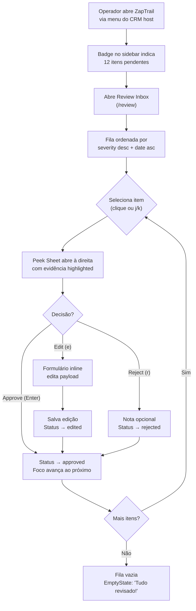
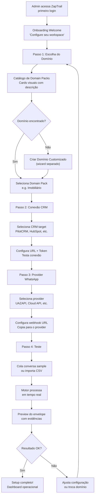
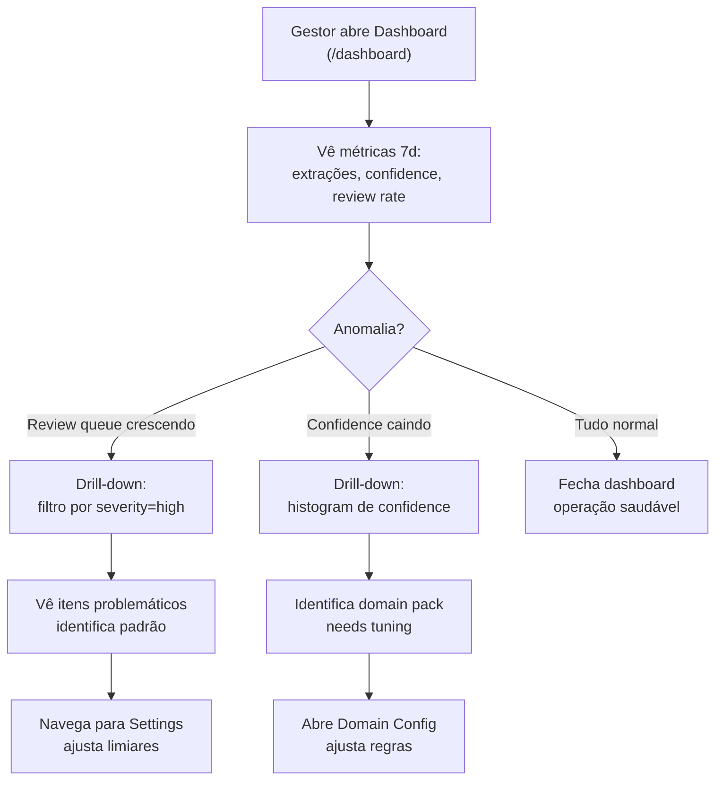
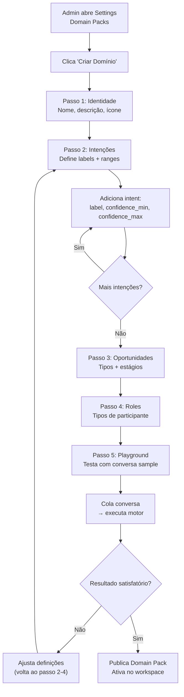
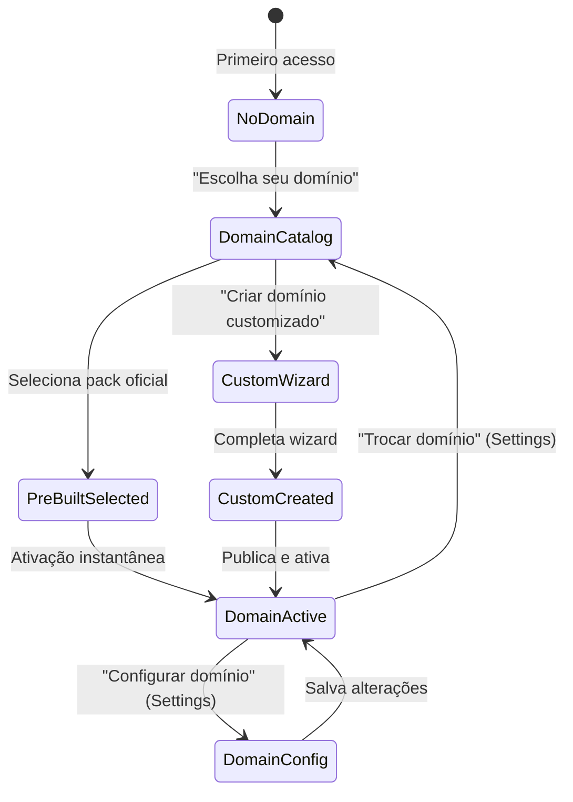
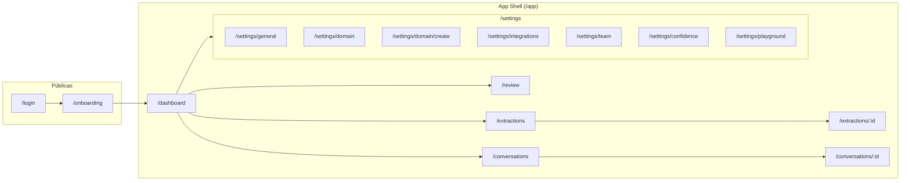

# ZapTrail — Product & UX Specification (Outside-In)

> **Status:** Design Specification — Awaiting Engineering Plan
> **Data:** 2026-11-05
> **Abordagem:** Outside-In (Personas → Problemas → Jornadas → Stories → Rotas → Fluxos → Páginas → Componentes → Estados → Design)
> **Design System:** PilotCRM Design System (OKLCH, Geist Sans/Mono, `@repo/ui`, h-14 datum line)
> **Benchmarks:** Linear, Attio, Folk, Superhuman, Stripe Dashboard, Supabase Studio, Raycast

---

## 1. Visão do Produto

**ZapTrail** é um motor de inteligência conversacional multi-domínio que transforma turnos de conversa de WhatsApp em registros de negócio estruturados, auditáveis e acionáveis.

### Princípios de Design

1. **Simplicidade Genial:** Cada tela resolve exatamente um problema. Zero chrome decorativo. A complexidade do motor semântico é invisível ao operador.
2. **Inteligência Pragmática:** O sistema mostra o que sabe, o quanto confia, e de onde tirou. Transparência epistêmica é feature, não detalhe técnico.
3. **Navegação Contextual:** O usuário nunca perde o contexto. Inspeção in-place (Peek Sheet), deep linking, filtros preservados, keyboard-first navigation.
4. **Domain-First Architecture:** A interface se adapta dinamicamente ao domínio ativo. Labels, campos, taxonomias, ícones e vocabulário vêm do Domain Pack plugado.

### Diferenciação Core vs. Domain

| Camada | Escopo | Exemplo |
|--------|--------|---------|
| **Universal Core** | Motor semântico, envelope, evidência, confiança, review inbox, storage | `UniversalInterpretationEnvelope`, `EvidenceRef`, `ConfidencePolicy` |
| **Domain Pack** | Taxonomia, regras de extração, vocabulário, tipos de oportunidade, adapter CRM | `RealEstateDomainPack`, `RealEstatePartyRole`, `iptu`, `condominio` |
| **UI Core** | Shell, review inbox, dashboard, configurações, domain selector | AppShell, ReviewInbox, DomainSetup, Settings |
| **UI Domain** | Labels dinâmicos, colunas domain-specific, filtros especializados, ícones de entidade | "Oportunidade Imobiliária" vs. "Oportunidade", colunas de preço vs. ticket médio |

---

## 2. Personas

### P1 — Operador de Campo

**Perfil:** Profissional na linha de frente (corretor imobiliário, consultor, vendedor) que conduz conversas via WhatsApp. Não acessa o ZapTrail diretamente.

**Contexto:** Ritmo acelerado, 30-80 conversas/dia, alterna entre celular e desktop. Quer resultado, não processo.

**Problemas:**
- Perde informações cruciais ditas em conversas que nunca são registradas no CRM
- Gasta 15-30min/dia digitando manualmente dados de conversas no sistema
- Esquece follow-ups prometidos verbalmente em conversas
- Dados duplicados ou inconsistentes por registro manual apressado

**JTBD:** *"Quando eu converso com um lead, quero que os dados relevantes sejam capturados automaticamente no meu CRM sem eu precisar digitar nada, para que eu foque no relacionamento e não perca oportunidades."*

**Interação com ZapTrail:** Indireta — vê as sugestões geradas pelo ZapTrail aparecerem no CRM host como propostas de enriquecimento. O ZapTrail é invisível para esta persona.

**Métricas de Sucesso:**
- Tempo de registro manual → 0
- Dados capturados por conversa ↑ 3-5x
- Oportunidades detectadas automaticamente ↑ 40%

---

### P2 — Operador de Revisão (Review Operator)

**Perfil:** Membro da equipe (pode ser o próprio Operador de Campo, um assistente administrativo, ou um supervisor) responsável por validar extrações com confiança média (0.65–0.84).

**Contexto:** Trabalha em batch — abre a fila de revisão 2-3x/dia, processa 10-50 itens por sessão. Precisa de velocidade e contexto imediato.

**Problemas:**
- Não sabe se uma extração automática está correta sem ver a conversa original
- Perda de contexto ao alternar entre fila de revisão e conversa
- Itens de revisão sem priorização — não sabe quais são urgentes
- Feedback loop lento — correções não melhoram o motor

**JTBD:** *"Quando o motor extrai algo incerto de uma conversa, quero ver o trecho exato da mensagem original destacado, decidir rapidamente se a extração está correta (aprovar / editar / rejeitar), e seguir para o próximo item — sem perder meu lugar na fila."*

**Interação com ZapTrail:** Direta — Fila de Revisão (Review Inbox) com navegação por teclado.

**Métricas de Sucesso:**
- Tempo médio de resolução por item < 15s
- Taxa de processamento da fila > 90% em 24h
- Zero decisões sem ver a evidência original

---

### P3 — Administrador de Workspace

**Perfil:** Gestor técnico, dono do negócio, ou responsável de TI que configura o workspace (tenant), seleciona e configura o Domain Pack ativo, gerencia integrações e usuários.

**Contexto:** Acessa configurações esporadicamente (setup inicial, onboarding de novos usuários, troubleshooting). Precisa de clareza e segurança — erros de configuração afetam toda a operação.

**Problemas:**
- Não sabe qual domínio/vertical se aplica ao seu negócio
- Configuração de integrações (CRM, WhatsApp provider) é técnica e intimidadora
- Não consegue ver se a integração está funcionando sem logs técnicos
- Gerenciamento de permissões (quem pode revisar, quem pode configurar) é confuso

**JTBD:** *"Quando eu configuro o ZapTrail para minha empresa, quero escolher o domínio do meu negócio, conectar meu CRM e definir quem pode revisar — sem precisar escrever código nem entender a arquitetura interna."*

**Interação com ZapTrail:** Painel de Configurações + Domain Setup Wizard + Integration Health.

**Métricas de Sucesso:**
- Tempo de setup completo < 10min (domínio pré-configurado) ou < 30min (domínio customizado)
- Zero erros de configuração silenciosos (health check visível)
- Self-service para 90% das configurações

---

### P4 — Gestor Comercial / Analista

**Perfil:** Líder de equipe, diretor comercial, ou analista de operações que quer visão macro sobre o que o motor está extraindo — volume, accuracy, oportunidades, taxa de review.

**Contexto:** Consulta dashboards 1-2x/dia. Precisa de métricas actionable, não dados brutos. Compara períodos, identifica tendências, calibra processos.

**Problemas:**
- Não sabe quantas oportunidades estão sendo perdidas por falta de processamento
- Não consegue medir a qualidade das extrações (accuracy, confidence distribution)
- Fila de revisão crescendo sem visibilidade de bottleneck
- Sem comparação temporal (este mês vs. anterior)

**JTBD:** *"Quando quero entender a saúde operacional da minha pipeline de inteligência conversacional, quero ver métricas de extração por período, distribuição de confiança, top oportunidades detectadas e taxa de resolução da fila — para calibrar meu time e o motor."*

**Interação com ZapTrail:** Dashboard analítico + Explorador de Extrações.

**Métricas de Sucesso:**
- Visibilidade completa em < 30s (dashboard load)
- Drill-down de métrica → envelope específico em 2 cliques
- Comparação temporal (7d, 30d, 90d) disponível

---

### P5 — Criador de Domain Pack (Power User / Futuro)

**Perfil:** Desenvolvedor, parceiro tecnológico, ou power user que quer adaptar o ZapTrail para um novo vertical (clínicas, food/delivery, consultoria B2B, educação).

**Contexto:** Entende a estrutura do Domain Pack, precisa de ferramentas para definir taxonomia sem forkar o código. Quer testar com conversas reais antes de publicar.

**Problemas:**
- Criar um Domain Pack requer entender a interface `DomainPack<TDomainEntities>` em código
- Não há UI para definir intenções, tipos de oportunidade, regras de extração
- Não consegue testar um pack novo com conversas sample antes de ativar em produção
- Sem marketplace/catálogo de Domain Packs existentes

**JTBD:** *"Quando preciso usar o ZapTrail em um novo segmento de negócio, quero definir minha taxonomia de intenções, tipos de oportunidade e regras de extração — e testar com conversas reais antes de ativar."*

**Interação com ZapTrail:** Domain Pack Builder (wizard avançado) + Playground de Teste.

**Métricas de Sucesso:**
- Domain Pack customizado funcional em < 2h (com wizard)
- Playground com feedback instantâneo (extração sample → resultado visual)
- Publicação/ativação com zero downtime

---

## 3. User Stories

### Epic 1: Revisão de Extrações (P2 — Review Operator)

| ID | User Story | Critérios de Aceitação |
|----|-----------|----------------------|
| **US-R01** | Como Operador de Revisão, quero ver uma fila de itens pendentes ordenados por severidade e data, para processar os mais urgentes primeiro. | Fila com colunas: severidade (badge), conversa, razão, evidência preview, data. Ordenação padrão: severity desc → created_at asc. Filtro por severity e conversation_id. |
| **US-R02** | Como Operador de Revisão, quero clicar em um item da fila e ver o trecho exato da conversa original com a citação destacada em amarelo (`<mark>`), para decidir com contexto completo. | Peek Sheet abre à direita com: evidência highlighted no corpo da mensagem, payload original formatado, botões approve/edit/reject. Fila permanece visível ao fundo. |
| **US-R03** | Como Operador de Revisão, quero aprovar um item com um único clique (ou `Enter`), para manter a velocidade de processamento. | Ação `approve`: status → `approved`, epistemic_status → `validated_human`. Foco avança automaticamente para o próximo item pendente. |
| **US-R04** | Como Operador de Revisão, quero editar o payload extraído antes de aprovar, para corrigir erros parciais sem rejeitar tudo. | Ação `edit`: formulário inline com campos do payload pré-preenchidos. Após salvar: status → `edited`, epistemic_status → `validated_human`, `prior_epistemic_status` → `superseded`. |
| **US-R05** | Como Operador de Revisão, quero rejeitar uma extração com nota opcional, para sinalizar falsos positivos ao sistema. | Ação `reject`: textarea opcional para notas. Status → `rejected`, epistemic_status → `rejected`. |
| **US-R06** | Como Operador de Revisão, quero navegar entre itens com `j`/`k` (ou ↑/↓) sem usar o mouse, para processar a fila com máxima velocidade. | Navegação por teclado: `j`/`↓` = próximo, `k`/`↑` = anterior, `Enter` = approve, `e` = edit, `r` = reject, `Esc` = fechar peek. |
| **US-R07** | Como Operador de Revisão, quero ver o "Mostrar na conversa" como link clicável que me leva direto ao ponto exato da conversa original no CRM host. | Link `anchor_href` gerado por `buildShowInConversationLink()` abre a conversa no CRM com scroll automático até a mensagem e highlight do trecho. |

### Epic 2: Configuração de Workspace & Domínio (P3 — Admin)

| ID | User Story | Critérios de Aceitação |
|----|-----------|----------------------|
| **US-A01** | Como Admin, quero um wizard de setup que me guie desde a escolha do domínio até a primeira extração funcional, para configurar sem documentação técnica. | Wizard 4 etapas: (1) Escolha do domínio, (2) Conexão do CRM, (3) Configuração do provider WhatsApp, (4) Teste com conversa sample. Progress bar visível. |
| **US-A02** | Como Admin, quero escolher um Domain Pack pré-configurado de um catálogo visual, para ativar meu domínio em 1 clique. | Catálogo com cards: nome, descrição, ícone, status (oficial/community/custom). Clique → ativa o pack para o workspace. Domain Packs disponíveis: Real Estate (MVP), Healthcare, B2B Services (futuro). |
| **US-A03** | Como Admin, quero criar um Domain Pack customizado definindo intenções, tipos de oportunidade e labels, para adaptar o ZapTrail ao meu nicho específico. | Wizard: (1) Nome e descrição do domínio, (2) Definição de intenções (label + confidence range), (3) Tipos de oportunidade, (4) Roles de participante, (5) Preview com conversa sample. |
| **US-A04** | Como Admin, quero ver o status de saúde das integrações (CRM conectado, webhook ativo, último processamento), para diagnosticar problemas sem abrir logs. | Card de Health com semáforo: 🟢 Conectado (< 5min desde último evento), 🟡 Lento (5-30min), 🔴 Desconectado (> 30min ou erro). Último evento com timestamp. |
| **US-A05** | Como Admin, quero gerenciar membros do workspace com roles (admin, reviewer, viewer), para controlar quem pode configurar vs. quem pode revisar. | Lista de membros com role selector (dropdown). Roles: `admin` (full access), `reviewer` (review inbox + read), `viewer` (read-only dashboards). Invite por email. |
| **US-A06** | Como Admin, quero alternar entre Domain Packs sem perder dados históricos, para pivotar ou expandir meu negócio. | Domain switch: confirmação modal, re-processamento opcional de conversas históricas, dados existentes preservados com `domain_key` original. |
| **US-A07** | Como Admin, quero configurar os limiares de confiança (auto/review/observe) do motor para ajustar o nível de automação ao meu apetite de risco. | 3 sliders: High band (default ≥ 0.85), Medium band (default 0.65–0.84), Low band (default < 0.65). Preview do impacto: "Com esses limiares, ~X% das extrações seriam automáticas, ~Y% iriam para revisão." |

### Epic 3: Exploração & Transparência (P2, P4)

| ID | User Story | Critérios de Aceitação |
|----|-----------|----------------------|
| **US-E01** | Como Operador ou Gestor, quero ver a lista de todas as extrações (envelopes) com filtros por conversa, domínio, data e status de revisão. | Tela Collection/Catalog com DataTable. Colunas: conversation_id, domain_key, created_at, review_required, opportunities count, confidence avg. Filtros: domain, date range, review status. |
| **US-E02** | Como Operador, quero clicar em um envelope e ver todos os seus componentes (participantes, intenções, fatos, valores, oportunidades, ações) com as evidências linkadas. | Peek Sheet ou Record Detail (3-rail) com abas por componente. Cada observação mostra: label, valor, confidence badge (cor por band), epistemic status, evidência com "Mostrar na conversa". |
| **US-E03** | Como Gestor, quero ver o timeline de uma conversa com as extrações sobrepostas, para entender o que o motor capturou em cada turno. | Timeline Dual: coluna esquerda = mensagens raw, coluna direita = envelopes extraídos, conectados visualmente por linhas de evidência. Trechos citados highlighted com `<mark>`. |
| **US-E04** | Como Gestor, quero ver métricas agregadas (volume de extrações, distribuição de confiança, taxa de review, top intenções) em um dashboard visual. | Dashboard com: (1) Extração volume chart (bar, 7d/30d), (2) Confidence distribution (histogram), (3) Review queue size & resolution rate, (4) Top 5 intenções detectadas, (5) Oportunidades por estágio. |

### Epic 4: Domínio Multi-Vertical (P3, P5)

| ID | User Story | Critérios de Aceitação |
|----|-----------|----------------------|
| **US-D01** | Como Admin, quero que a UI se adapte automaticamente ao Domain Pack ativo, mostrando labels, ícones e vocabulário do meu domínio. | Labels dinâmicos: "Oportunidade" genérico → "Oportunidade Imobiliária" quando `domain_key=real_estate`. Colunas de DataTable domain-specific (e.g., `sale_asking_price` no real estate, `consultation_fee` em healthcare). |
| **US-D02** | Como Admin, quero ver um indicador claro de qual domínio está ativo no meu workspace, para nunca confundir o contexto. | Badge persistente no header do AppShell: `[Imobiliário]` ou `[Healthcare]` com ícone do domínio. Clique → abre settings do domínio. |
| **US-D03** | Como Criador de Domain Pack, quero um playground onde posso colar uma conversa sample e ver em tempo real o que o motor extrairia com meu pack customizado. | Textarea para input de conversa + botão "Extrair". Resultado: envelope formatado com todos os componentes, evidências highlighted, confidence badges. Tempo de processamento visível. |

---

## 4. Jornadas de Usuário

### J1 — Jornada do Operador de Revisão: Processar a Fila Matinal



### J2 — Jornada do Admin: Setup Inicial do Workspace



### J3 — Jornada do Gestor: Diagnóstico de Saúde Operacional



### J4 — Jornada do Admin: Criar Domain Pack Customizado



---

## 5. Modelo Multi-Domínio (UX)

### 5.1 Conceitos Chave

O ZapTrail opera com uma separação rigorosa entre **Core** (universal, domain-agnostic) e **Domain Pack** (plugável, domain-specific). Na UI, isso se manifesta em:

| Aspecto | Core (fixo) | Domain Pack (dinâmico) |
|---------|-------------|----------------------|
| **Labels** | "Extração", "Envelope", "Evidência", "Confiança" | "Oportunidade Imobiliária", "Captação", "Demanda de Compra" |
| **Colunas de tabela** | conversation_id, created_at, confidence, review_status | sale_asking_price, property_type, iptu (real estate) |
| **Filtros** | domain_key, date range, severity | property_type, neighborhood, price range (real estate) |
| **Ícones de entidade** | 📋 Envelope, 🔍 Evidência, ⚠️ Review | 🏠 Imóvel, 💰 Valor, 👤 Proprietário (real estate) |
| **Ações** | approve, edit, reject | qualify_property, request_media (real estate) |

### 5.2 Domain Registry & Selection



### 5.3 Como Labels Dinâmicos Funcionam

O Domain Pack expõe um **vocabulário** que a UI consome para renderizar labels, placeholders e tooltips:

```typescript
// Contrato do Domain Pack para a UI (proposta)
interface DomainPackUIManifest {
  domain_key: string;
  display_name: string;           // "Imobiliário"
  icon: string;                   // "building-2" (lucide)
  description: string;            // "Extração de oportunidades imobiliárias..."
  
  // Vocabulário de labels
  labels: {
    opportunity: string;          // "Oportunidade Imobiliária"
    participant: string;          // "Participante"
    intent: string;               // "Intenção"
    entity: string;               // "Imóvel"
  };
  
  // Colunas extras para DataTable de envelopes
  extra_columns: Array<{
    key: string;                  // "sale_asking_price"
    label: string;                // "Preço de Venda"
    type: 'currency' | 'text' | 'number' | 'badge';
    path: string;                 // "domain_entities.asking_price"
  }>;
  
  // Filtros extras
  extra_filters: Array<{
    key: string;
    label: string;
    type: 'select' | 'range' | 'text';
    options?: Array<{ value: string; label: string }>;
  }>;
  
  // Intent labels para exibição
  intent_labels: Record<string, string>;  // "intent.capture_for_sale" → "Captação para Venda"
  
  // Opportunity type labels
  opportunity_labels: Record<string, string>;
  
  // Role labels
  role_labels: Record<string, string>;
}
```

### 5.4 Domain Indicator no AppShell

O domain ativo é exibido como badge persistente no header, garantindo que o operador sempre saiba em qual contexto está:

```
┌──────────────────────────────────────────────────────────────┐
│ 🔗 ZapTrail    [🏠 Imobiliário ▾]         🔔 3  👤 Admin   │  ← h-14 header
├──────────────────────────────────────────────────────────────┤
```

O badge é clicável e abre um dropdown com:
- Nome do domínio ativo
- "Configurar domínio" → Settings > Domain
- "Trocar domínio" → Domain Catalog (com confirmação)

---

## 6. Arquitetura de Informação

### 6.1 Mapa de Rotas



### 6.2 Navegação Principal (Sidebar)

```
┌─────────────────────────┐
│ 🔗 ZapTrail             │  Logo + domain badge
│ [🏠 Imobiliário]        │
├─────────────────────────┤
│                         │
│ 📊 Dashboard            │  /dashboard
│ 📥 Revisão        (12)  │  /review          ← badge com count pendente
│ 📋 Extrações            │  /extractions
│ 💬 Conversas            │  /conversations
│                         │
├─────────────────────────┤
│                         │
│ ⚙️ Configurações        │  /settings/general
│                         │
└─────────────────────────┘
```

**Regras de navegação:**
- Sidebar persistente em desktop (`w-64`, `h-14` header)
- Badge de contagem apenas na Revisão (itens pendentes)
- Mobile: sidebar oculta, bottom nav com 4 itens (Dashboard, Revisão, Extrações, Menu)
- Active state: `bg-accent` + `text-accent-foreground` + borda esquerda `primary`

### 6.3 Hierarquia de Páginas por Arquétipo

| Rota | Arquétipo | Descrição |
|------|-----------|-----------|
| `/dashboard` | **Custom** (cards + charts) | Métricas operacionais, health indicators, shortcuts |
| `/review` | **Collection/Catalog** | Fila de revisão com Peek Sheet |
| `/extractions` | **Collection/Catalog** | Lista de envelopes com filtros |
| `/extractions/:id` | **Record/Detail (3-Rail)** | Detalhe do envelope com componentes |
| `/conversations` | **Collection/Catalog** | Lista de conversas processadas |
| `/conversations/:id` | **Record/Detail (3-Rail)** | Timeline Dual (mensagens + extrações) |
| `/settings/general` | **Settings/Form** | Nome do workspace, timezone, idioma |
| `/settings/domain` | **Settings/Form** + Catalog | Domínio ativo, catálogo, configuração |
| `/settings/domain/create` | **Wizard** (multi-step) | Criação de Domain Pack customizado |
| `/settings/integrations` | **Settings/Form** | CRM + WhatsApp provider config + health |
| `/settings/team` | **Collection/Catalog** | Lista de membros + roles |
| `/settings/confidence` | **Settings/Form** | Limiares de confiança |
| `/settings/playground` | **Custom** (split pane) | Teste de extração com conversa sample |

---

## 7. Design de Páginas

### 7.1 Dashboard (`/dashboard`)

**Propósito:** Visão operacional instantânea — o gestor abre e em 5 segundos sabe se a operação está saudável.

**Layout:** Grid responsivo de cards (2 colunas desktop, 1 coluna mobile).

**Componentes:**

```
┌──────────────────────────────────────────────────────────────┐
│ PageHeader: "Dashboard"                              [7d ▾]  │
├────────────────────────────┬─────────────────────────────────┤
│                            │                                 │
│  📊 Extrações Hoje         │  📥 Fila de Revisão             │
│  ┌──────────────────────┐  │  ┌───────────────────────────┐  │
│  │  47 extrações        │  │  │  12 pendentes             │  │
│  │  ↑ 15% vs. ontem     │  │  │  3 alta · 5 média · 4 bx │  │
│  │  ▁▂▃▄▅▆▇█▇▆ (7d)    │  │  │  [Abrir Fila →]          │  │
│  └──────────────────────┘  │  └───────────────────────────┘  │
│                            │                                 │
│  🎯 Confiança Média        │  🔗 Integrações                 │
│  ┌──────────────────────┐  │  ┌───────────────────────────┐  │
│  │  0.82                │  │  │  CRM: 🟢 Conectado        │  │
│  │  High 63% · Med 28%  │  │  │  WhatsApp: 🟢 Ativo       │  │
│  │  Low 9%              │  │  │  Último evento: 2min      │  │
│  └──────────────────────┘  │  └───────────────────────────┘  │
│                            │                                 │
│  💡 Top Oportunidades (7d) │  📈 Tendência de Volume         │
│  ┌──────────────────────┐  │  ┌───────────────────────────┐  │
│  │  1. Captação Venda 23│  │  │  ▁▂▃▄▅▆▇█▇▆▅▄▃▂▁ (30d)  │  │
│  │  2. Demanda Compra 15│  │  │                           │  │
│  │  3. Captação Aluguel 8│  │  │                           │  │
│  └──────────────────────┘  │  └───────────────────────────┘  │
└────────────────────────────┴─────────────────────────────────┘
```

**5 Estados:**
1. **Ideal:** Grid de cards com dados reais, números formatados com `Geist Mono`
2. **Loading:** `SkeletonCard` 1:1 na posição de cada card, sem spinner
3. **Empty (novo workspace):** "Nenhuma extração ainda. Configure suas integrações para começar." + CTA "Configurar Integrações"
4. **Error:** Card com `role="alert"`, mensagem humanizada, botão "Tentar Novamente"
5. **Filtered Empty:** N/A (dashboard não tem filtros de busca)

---

### 7.2 Review Inbox (`/review`)

**Propósito:** Fila operacional de revisão — a tela onde o Operador de Revisão passa a maior parte do tempo no ZapTrail.

**Layout:** Arquétipo Collection/Catalog com Peek Sheet.

**Componentes:**

```
┌──────────────────────────────────────────────────────────────────────────┐
│ PageHeader: "Revisão"    Badge(12 pendentes)           [Filtros ▾]      │
├──────────────────────────────────────────────────────────────────────────┤
│ FilterToolbar: [Todas ▾] [Severidade ▾] [Conversa ▾] 🔍 Buscar...      │
├──────────────────────────────────────────────────────────────────────────┤
│                                                                          │
│  ┌─ DataTable ──────────────────────────────────┐  ┌─ Peek Sheet ─────┐ │
│  │ SEV │ CONVERSA     │ RAZÃO          │ DATA   │  │                   │ │
│  │─────│──────────────│────────────────│────────│  │ Review #rv_123    │ │
│  │ 🔴  │ conv_abc     │ Preço ambíguo  │ 10:23  │  │                   │ │
│  │ 🟡  │ conv_def ◀── │ Role incerto   │ 09:45  │  │ EVIDÊNCIA:        │ │
│  │ 🟡  │ conv_ghi     │ Intent dupla   │ 09:12  │  │ "...esse apt é   │ │
│  │ 🟢  │ conv_jkl     │ Valor baixo    │ 08:55  │  │ meu e do meu     │ │
│  │ 🟢  │ conv_mno     │ Conf. limiar   │ 08:30  │  │ [marido], estamos│ │
│  │     │              │                │        │  │ pensando em       │ │
│  │     │              │                │        │  │ vender..."        │ │
│  │     │              │                │        │  │                   │ │
│  │     │              │                │        │  │ PAYLOAD:          │ │
│  │     │              │                │        │  │ role: spouse_or_  │ │
│  │     │              │                │        │  │       partner     │ │
│  │     │              │                │        │  │ confidence: 0.72  │ │
│  │     │              │                │        │  │                   │ │
│  │     │              │                │        │  │ [Aprovar] [Editar]│ │
│  │     │              │                │        │  │ [Rejeitar]        │ │
│  └─────────────────────────────────────────────┘  └───────────────────┘ │
│  Exibindo 5 de 12 pendentes                        j↓ k↑ Enter ⏎ Esc ✕ │
└──────────────────────────────────────────────────────────────────────────┘
```

**Colunas da DataTable:**

| Coluna | Tipo | Alinhamento | Descrição |
|--------|------|-------------|-----------|
| Severidade | Badge (🔴 high, 🟡 medium, 🟢 low) | Centro | `review_item.severity` |
| Conversa | Text (truncado) | Esquerda | `conversation_id` com tooltip do full ID |
| Razão | Text | Esquerda | `review_item.reason` |
| Evidência | Text (preview 50 chars) | Esquerda | First `evidence_ref.exact_quote` truncado |
| Data | Relative time (`Geist Mono`) | Direita | `created_at` formatado como "há 2h", "10:23" |
| Status | Badge | Centro | pending / approved / edited / rejected |

**Peek Sheet (lado direito):**
- **Header:** Review ID + severity badge + conversation link
- **Seção Evidência:** Mensagem original com `<mark>` no trecho citado. Fonte `Geist Mono` para o quote.
- **Seção Payload:** Key-value list do `original_payload` com badges de confidence por campo.
- **Seção Ações:** 3 botões com atalhos de teclado
  - `Aprovar` (Enter) — `variant="default"` (primary)
  - `Editar` (e) — `variant="secondary"`
  - `Rejeitar` (r) — `variant="ghost"` com `text-destructive`
- **Seção Notas (para edit/reject):** `Textarea` expansível para `reviewer_notes`

**Keyboard Shortcuts:**

| Tecla | Ação |
|-------|------|
| `j` / `↓` | Próximo item na fila |
| `k` / `↑` | Item anterior |
| `Enter` | Aprovar item selecionado |
| `e` | Abrir modo edição |
| `r` | Rejeitar item selecionado |
| `Esc` | Fechar Peek Sheet |
| `Cmd+F` | Foco no campo de busca |

**5 Estados:**
1. **Ideal:** DataTable populada, Peek Sheet no primeiro item
2. **Loading:** `SkeletonTable` com 5 rows, sem spinner
3. **Empty (fila vazia):** "Tudo revisado! 🎉 Nenhum item pendente." Sem CTA (não há ação para fila vazia)
4. **Filtered Empty:** "Nenhum item encontrado para os filtros selecionados." + botão "Limpar Filtros"
5. **Error:** `role="alert"`, "Não foi possível carregar a fila de revisão." + "Tentar Novamente"

---

### 7.3 Extrações (`/extractions`)

**Propósito:** Catálogo de todos os envelopes de interpretação processados — visão operacional e de auditoria.

**Layout:** Arquétipo Collection/Catalog com Peek Sheet.

**Componentes:**

```
┌──────────────────────────────────────────────────────────────────────────┐
│ PageHeader: "Extrações"    Badge(1.247 total)    [Exportar] [Filtros ▾] │
├──────────────────────────────────────────────────────────────────────────┤
│ FilterToolbar: [Domínio ▾] [Período ▾] [Revisão ▾] 🔍 Buscar...       │
├──────────────────────────────────────────────────────────────────────────┤
│                                                                          │
│  ┌─ DataTable ──────────────────────────────────────────────────────────┐ │
│  │ CONVERSA     │ DOMÍNIO   │ OPORTUNIDADES │ CONF.  │ REVISÃO │ DATA  │ │
│  │──────────────│───────────│───────────────│────────│─────────│───────│ │
│  │ conv_abc     │ 🏠 Imob.  │ 2             │ 0.91   │ ✅      │ 10:23 │ │
│  │ conv_def     │ 🏠 Imob.  │ 1             │ 0.73   │ ⏳      │ 09:45 │ │
│  │ conv_ghi     │ 🏠 Imob.  │ 0             │ 0.42   │ ❌      │ 09:12 │ │
│  └──────────────────────────────────────────────────────────────────────┘ │
│  Exibindo 1-20 de 1.247                                    ◀ 1 2 3 ... ▶│
└──────────────────────────────────────────────────────────────────────────┘
```

**Colunas (Core + Domain-Specific):**

Core (sempre presentes):
| Coluna | Tipo | Descrição |
|--------|------|-----------|
| Conversa | Link | `conversation_id` → `/conversations/:id` |
| Domínio | Badge + ícone | `domain_key` formatado pelo `DomainPackUIManifest` |
| Oportunidades | Number (`Geist Mono`) | `opportunities.length` |
| Confiança Média | Number + color badge | Média de `confidence` com cor por band |
| Revisão | Status icon | ✅ all approved, ⏳ pending, ❌ has rejected |
| Data | Relative time | `created_at` |

Domain-Specific (vindas de `extra_columns` do manifest):
- Real Estate: `Preço de Venda`, `Tipo de Imóvel`, `Bairro`
- Healthcare: `Tipo de Consulta`, `Especialidade`
- B2B: `Ticket Médio`, `Segmento`

**5 Estados:** Mesmos padrões de `/review` (ideal, skeleton, empty com CTA "Configure suas integrações", filtered empty, error).

---

### 7.4 Detalhe de Extração (`/extractions/:id`)

**Propósito:** Visão completa de um envelope — todos os componentes semânticos com evidências linkadas.

**Layout:** Arquétipo Record/Detail (3-Rail).

```
┌──────────────────────────────────────────────────────────────────────────┐
│ Breadcrumb: Extrações > conv_abc > Envelope #env_123                     │
│ Status: ✅ Processado  │  Domínio: 🏠 Imobiliário  │  Conf: 0.91       │
├──────────────────┬──────────────────────────┬────────────────────────────┤
│ IDENTIDADE       │ COMPONENTES              │ AÇÕES & OPORTUNIDADES      │
│ (Left Rail 30%)  │ (Center Rail 45%)        │ (Right Rail 25%)           │
│                  │                          │                            │
│ Envelope ID      │ [Participantes] [Intents]│ Oportunidades              │
│ env_123          │ [Fatos] [Valores]        │ ┌────────────────────────┐ │
│                  │ [Relações] [Condições]   │ │ 🏠 Captação Venda      │ │
│ Conversa         │                          │ │ Stage: detected        │ │
│ conv_abc →       │ ── Tab: Participantes ── │ │ Conf: 0.91             │ │
│                  │                          │ │ Preço: R$ 1.200.000    │ │
│ Tenant           │ 👤 Proprietário          │ └────────────────────────┘ │
│ tenant_xyz       │ role: owner              │                            │
│                  │ conf: 0.95 🟢            │ Ações Recomendadas         │
│ Turn ID          │ epistemic: declared      │ ┌────────────────────────┐ │
│ turn_456         │ evidence: "Sou o dono"   │ │ qualify_property       │ │
│                  │ [Mostrar na conversa →]  │ │ mode: auto             │ │
│ Domain Key       │                          │ │ conf: 0.91             │ │
│ real_estate      │ 👤 Cônjuge               │ └────────────────────────┘ │
│                  │ role: spouse_or_partner   │                            │
│ Parser Version   │ conf: 0.72 🟡            │ Review Items               │
│ 1.5.0            │ epistemic: inferred      │ ┌────────────────────────┐ │
│                  │ evidence: "meu marido"   │ │ ⚠️ Role incerto        │ │
│ Extractor        │ [Mostrar na conversa →]  │ │ severity: medium       │ │
│ hybrid           │                          │ │ [Resolver →]           │ │
│                  │                          │ └────────────────────────┘ │
│ LLM Invoked      │                          │                            │
│ ✅ Sim           │                          │                            │
└──────────────────┴──────────────────────────┴────────────────────────────┘
```

**Abas do Center Rail:**
1. **Participantes** — `ParticipantObservation[]` com role, confidence, epistemic status, evidence link
2. **Intenções** — `IntentObservation[]` com intent label (domain-translated), target entity, confidence
3. **Fatos** — `FactObservation[]` com fact key/value, target entity, confidence
4. **Valores** — `ValueObservation[]` com field, amount (Geist Mono, currency format), evolution indicator (superseded badge)
5. **Relações** — `RelationshipObservation[]` com source → target, relation type, referred contact
6. **Condições** — `ConditionObservation[]` com condition type, linked opportunities, description

**Cada observação exibe:**
- Label traduzido pelo domain manifest
- Valor formatado (currency com `Geist Mono`, texto, badge)
- Confidence badge com cor semântica (🟢 ≥ 0.85, 🟡 0.65–0.84, 🔴 < 0.65)
- Epistemic status badge (`declared`, `inferred`, `validated_human`, `superseded`, `rejected`)
- Link "Mostrar na conversa" → navega para `/conversations/:id?anchor=msg_xxx` com highlight

**5 Estados:**
1. **Ideal:** 3-rail completo com todos os componentes
2. **Loading:** Skeleton em cada rail
3. **Empty:** Envelope sem dados (processing error) — "Esta extração não gerou resultados. Verifique a conversa original."
4. **Error:** "Não foi possível carregar o envelope." + "Tentar Novamente"
5. **Partial:** Envelope com `review_required=true` — banner amarelo "Esta extração contém itens pendentes de revisão." com link para `/review?conversation_id=xxx`

---

### 7.5 Conversas (`/conversations`)

**Propósito:** Lista de todas as conversas processadas pelo motor — permite navegar do contexto original para as extrações.

**Layout:** Arquétipo Collection/Catalog.

**Colunas:**

| Coluna | Tipo | Descrição |
|--------|------|-----------|
| Conversa | Text + Avatar | `conversation_id` com nome do contato principal (se detectado) |
| Mensagens | Number | Total de mensagens na conversa |
| Extrações | Number | Total de envelopes gerados |
| Última Atividade | Relative time | Timestamp da mensagem mais recente |
| Oportunidades | Number | Total de oportunidades detectadas across envelopes |

---

### 7.6 Timeline Dual (`/conversations/:id`)

**Propósito:** A tela de transparência máxima — mostra a conversa original lado a lado com tudo que o motor extraiu dela.

**Layout:** Split pane vertical (50/50 em desktop, stacked em mobile).

```
┌──────────────────────────────────────────────────────────────────────────┐
│ Breadcrumb: Conversas > conv_abc        [Domínio: 🏠 Imob.] [Ver JSON] │
├───────────────────────────────┬──────────────────────────────────────────┤
│ 💬 CONVERSA ORIGINAL          │ 🧠 EXTRAÇÕES SEMÂNTICAS                  │
│                               │                                          │
│ ┌───────────────────────────┐ │ ┌──────────────────────────────────────┐ │
│ │ 📤 Corretor (10:01)       │ │ │ Envelope #env_001 (10:01)           │ │
│ │ "Bom dia! Você é o       │ │ │ ── Turno de contexto outbound ──    │ │
│ │ proprietário do apto na   │ │ │ (sem extração — msg outbound)       │ │
│ │ Rua das Flores, 123?"    │ │ └──────────────────────────────────────┘ │
│ └───────────────────────────┘ │                                          │
│                               │ ┌──────────────────────────────────────┐ │
│ ┌───────────────────────────┐ │ │ Envelope #env_002 (10:05)           │ │
│ │ 📥 Contato (10:05)        │─┼─│                                      │ │
│ │ "Sou o dono sim, estou   │ │ │ 👤 owner (0.95 🟢)                  │ │
│ │ vendendo por [1,2 milhão] │ │ │ 💰 sale: R$ 1.200.000 (0.98 🟢)   │ │
│ │ mas minha [esposa] quer  │ │ │ 👤 spouse_or_partner (0.72 🟡) ⚠️  │ │
│ │ 1,3."                    │ │ │ 🎯 capture_for_sale (0.91 🟢)      │ │
│ └───────────────────────────┘ │ │ ⚡ qualify_property (auto)          │ │
│                               │ │                                      │ │
│ ┌───────────────────────────┐ │ │ [Ver detalhes →]                    │ │
│ │ 📥 Contato (10:06)        │ │ └──────────────────────────────────────┘ │
│ │ "Ah, e o IPTU é 3.200   │ │                                          │
│ │ por ano"                 │ │                                          │
│ └───────────────────────────┘ │                                          │
└───────────────────────────────┴──────────────────────────────────────────┘
```

**Interações:**
- Hover sobre uma extração no painel direito → highlight da mensagem correspondente no painel esquerdo (e vice-versa)
- Click em `[Mostrar na conversa →]` em qualquer observação → scroll + highlight no painel esquerdo
- Click em `[Ver detalhes →]` → navega para `/extractions/:id`
- Trechos citados (`exact_quote`) renderizados com `<mark class="bg-warning/20">` no painel esquerdo

---

### 7.7 Configurações — Geral (`/settings/general`)

**Propósito:** Configurações básicas do workspace.

**Layout:** Arquétipo Settings/Form.

**Seções:**
1. **Workspace** — Nome, Descrição, Timezone
2. **Idioma** — Idioma da interface (pt-BR default)
3. **Notificações** — Email digest frequency (diário, semanal, off)
4. **Zona de Perigo** — Excluir workspace (Dialog de confirmação com typing confirm)

---

### 7.8 Configurações — Domínio (`/settings/domain`)

**Propósito:** Gerenciamento do Domain Pack ativo e catálogo de packs disponíveis.

**Layout:** Settings/Form + Catalog cards.

**Seções:**

1. **Domínio Ativo** — Card expandido com:
   - Nome, ícone, descrição
   - Status: Ativo desde [data]
   - Parser version
   - Estatísticas: X extrações processadas, Y intenções configuradas
   - Botões: "Configurar" (abre sub-settings), "Trocar Domínio" (abre catálogo)

2. **Catálogo de Domain Packs** — Grid de cards:
   ```
   ┌─────────────┐  ┌─────────────┐  ┌─────────────┐  ┌─────────────┐
   │ 🏠           │  │ 🏥           │  │ 💼           │  │ ➕           │
   │ Imobiliário  │  │ Saúde       │  │ B2B Services │  │ Criar       │
   │ ✅ Ativo     │  │ Em breve    │  │ Em breve     │  │ Customizado │
   │              │  │             │  │              │  │             │
   │ [Configurar] │  │ [Notificar] │  │ [Notificar]  │  │ [Criar →]   │
   └─────────────┘  └─────────────┘  └─────────────┘  └─────────────┘
   ```

3. **Configuração Domain-Specific** (expandível por domínio):
   - Intenções configuradas (lista editável)
   - Tipos de oportunidade
   - Roles de participante
   - Labels customizados

---

### 7.9 Configurações — Integrações (`/settings/integrations`)

**Propósito:** Conexão e monitoramento de CRM target e WhatsApp provider.

**Layout:** Arquétipo Settings/Form com Health cards.

**Seções:**

1. **CRM Target**
   ```
   ┌──────────────────────────────────────────────────┐
   │ 🔗 PilotCRM                      Status: 🟢      │
   │                                                    │
   │ URL:     https://pilotcrm.app/api/...             │
   │ Token:   ••••••••••••abc                          │
   │ Último evento: há 2 minutos                       │
   │ Eventos hoje: 47 enviados, 0 erros                │
   │                                                    │
   │ [Testar Conexão]  [Editar]                        │
   └──────────────────────────────────────────────────┘
   ```

2. **WhatsApp Provider**
   ```
   ┌──────────────────────────────────────────────────┐
   │ 📱 UAZAPI                        Status: 🟢      │
   │                                                    │
   │ Webhook URL: https://zaptrail.app/api/v1/ingest  │
   │ Token: ••••••••••••xyz                            │
   │ Último webhook: há 5 minutos                      │
   │ Webhooks hoje: 83 recebidos                       │
   │                                                    │
   │ [Testar Webhook]  [Editar]  [Copiar URL]         │
   └──────────────────────────────────────────────────┘
   ```

3. **Callback Outbound** — URL + token para onde o ZapTrail envia propostas processadas

---

### 7.10 Configurações — Equipe (`/settings/team`)

**Propósito:** Gerenciamento de membros e roles do workspace.

**Layout:** Arquétipo Collection/Catalog.

```
┌──────────────────────────────────────────────────────────────────────────┐
│ PageHeader: "Equipe"    Badge(5 membros)                [Convidar +]    │
├──────────────────────────────────────────────────────────────────────────┤
│                                                                          │
│  NOME                │ EMAIL                │ ROLE           │ STATUS    │
│  ────────────────────│──────────────────────│────────────────│───────    │
│  Gustavo Pereira     │ gustavo@...          │ Admin     ▾    │ 🟢 Ativo │
│  Maria Santos        │ maria@...            │ Reviewer  ▾    │ 🟢 Ativo │
│  João Silva          │ joao@...             │ Reviewer  ▾    │ 🟡 Convite│
│  Ana Costa           │ ana@...              │ Viewer    ▾    │ 🟢 Ativo │
│                                                                          │
└──────────────────────────────────────────────────────────────────────────┘
```

**Roles:**
- `admin` — Configurações completas, review, visualização
- `reviewer` — Review inbox, visualização de extrações e conversas
- `viewer` — Apenas dashboard e visualização (read-only)

---

### 7.11 Configurações — Confiança (`/settings/confidence`)

**Propósito:** Ajuste dos limiares de confiança do motor.

**Layout:** Arquétipo Settings/Form.

```
┌──────────────────────────────────────────────────────────────────────────┐
│ PageHeader: "Limiares de Confiança"                                      │
│ "Ajuste os limiares para controlar o nível de automação do motor."       │
├──────────────────────────────────────────────────────────────────────────┤
│                                                                          │
│  🟢 Band Alta (Automático)                                               │
│  ┌────────────────────────────────────────────────────┐                  │
│  │ Mínimo: [0.85] ────────●───────────────── [1.00]  │                  │
│  │ Ações nessa faixa são executadas automaticamente.  │                  │
│  └────────────────────────────────────────────────────┘                  │
│                                                                          │
│  🟡 Band Média (Revisão)                                                 │
│  ┌────────────────────────────────────────────────────┐                  │
│  │ Mínimo: [0.65] ─────●──────────────────── [0.84]  │                  │
│  │ Extrações vão para a fila de revisão humana.       │                  │
│  └────────────────────────────────────────────────────┘                  │
│                                                                          │
│  🔴 Band Baixa (Observação)                                              │
│  ┌────────────────────────────────────────────────────┐                  │
│  │ [0.00] ──────────────────────────────────● [0.64]  │                  │
│  │ Registradas como hipóteses. Não sobrescrevem       │                  │
│  │ dados confirmados.                                 │                  │
│  └────────────────────────────────────────────────────┘                  │
│                                                                          │
│  📊 Impacto Estimado (últimos 30 dias)                                   │
│  ┌────────────────────────────────────────────────────┐                  │
│  │ Com esses limiares:                                │                  │
│  │ • ~63% das extrações seriam automáticas            │                  │
│  │ • ~28% iriam para revisão                          │                  │
│  │ • ~9% seriam observação                            │                  │
│  └────────────────────────────────────────────────────┘                  │
│                                                                          │
│                                      [Restaurar Padrão] [Salvar]         │
└──────────────────────────────────────────────────────────────────────────┘
```

---

### 7.12 Playground (`/settings/playground`)

**Propósito:** Ambiente de teste para o motor de extração — cola uma conversa e vê o resultado em tempo real.

**Layout:** Split pane horizontal (input left, output right).

```
┌──────────────────────────────────────────────────────────────────────────┐
│ PageHeader: "Playground"          [Domínio: 🏠 Imob. ▾] [Limpar]       │
├───────────────────────────────┬──────────────────────────────────────────┤
│ 📝 ENTRADA                    │ 🧠 RESULTADO                             │
│                               │                                          │
│ ┌───────────────────────────┐ │ ┌──────────────────────────────────────┐ │
│ │ Cole uma conversa aqui... │ │ │ (aguardando input)                   │ │
│ │                           │ │ │                                      │ │
│ │ Corretor: Bom dia, você  │ │ │ ── Processando... ──                 │ │
│ │ é proprietário do apto?  │ │ │                                      │ │
│ │                           │ │ │ ✅ Extração concluída (1.2s)         │ │
│ │ Contato: Sou o dono sim, │ │ │                                      │ │
│ │ vendendo por 1,2 milhão. │ │ │ 👤 Participantes: 2                  │ │
│ │                           │ │ │ 🎯 Intenções: 1                     │ │
│ │                           │ │ │ 💰 Valores: 1                       │ │
│ │                           │ │ │ 🏠 Oportunidades: 1                 │ │
│ │                           │ │ │                                      │ │
│ │                           │ │ │ [Expandir JSON]  [Ver Envelope →]   │ │
│ └───────────────────────────┘ │ └──────────────────────────────────────┘ │
│                               │                                          │
│ [▶ Extrair]                   │                                          │
└───────────────────────────────┴──────────────────────────────────────────┘
```

---

## 8. Inventário de Componentes

### 8.1 Componentes Core (domain-agnostic)

| Componente | Camada | Descrição | Dependência `@repo/ui` |
|-----------|--------|-----------|----------------------|
| `AppShell` | Shell | Layout principal: sidebar + header + content area | `Sidebar`, `Button`, `Badge` |
| `DomainIndicator` | Shell | Badge do domínio ativo no header | `Badge`, `DropdownMenu` |
| `ReviewInboxTable` | Feature | DataTable da fila de revisão com sorting + filtering | `DataTable`, `Badge`, `DropdownMenu` |
| `ReviewPeekSheet` | Feature | Peek Sheet com evidência highlighted + actions | `Sheet`, `Button`, `Badge`, `Textarea` |
| `EvidenceHighlight` | Feature | Renderiza mensagem com `<mark>` no trecho citado | Custom (`mark` element) |
| `ConfidenceBadge` | Data Display | Badge colorido por band (🟢/🟡/🔴) | `Badge` |
| `EpistemicStatusBadge` | Data Display | Badge do status epistêmico | `Badge` |
| `ShowInConversationLink` | Navigation | Link que navega para a mensagem exata na conversa | `Button` (variant="link") |
| `EnvelopeCard` | Data Display | Card resumo de um envelope | `Card`, `Badge` |
| `ObservationRow` | Data Display | Linha de uma observação com confidence + evidence | Custom |
| `TimelineDual` | Feature | Split pane com conversa original + extrações | Custom |
| `TimelineMessage` | Data Display | Bolha de mensagem (inbound/outbound) | Custom |
| `TimelineExtraction` | Data Display | Card de extração na timeline | `Card`, `Badge` |
| `MetricCard` | Dashboard | Card de métrica com valor, trend, sparkline | `Card` |
| `HealthIndicator` | Status | Semáforo de saúde da integração | `Badge` |
| `IntegrationCard` | Settings | Card de configuração de integração | `Card`, `Button`, `Input` |
| `ConfidenceSlider` | Settings | Slider de limiar de confiança | `Slider`, `Label` |
| `DomainPackCard` | Settings | Card do catálogo de Domain Packs | `Card`, `Badge`, `Button` |
| `DomainCreateWizard` | Settings | Wizard multi-step para criar Domain Pack | `Dialog`, `Button`, `Input`, `Tabs` |
| `PlaygroundSplitPane` | Feature | Split pane input/output do playground | `Textarea`, `Card` |
| `MemberRow` | Settings | Linha da lista de membros com role selector | `DropdownMenu`, `Badge`, `Avatar` |
| `SetupWizard` | Onboarding | Wizard 4 etapas de onboarding | `Dialog`, `Button`, `Tabs` |
| `PageHeader` | Layout | Header padronizado com título, badge, ações | `Badge`, `Button` |
| `FilterToolbar` | Layout | Barra de filtros com busca, dropdowns, chips | `Input`, `DropdownMenu`, `Badge` |
| `EmptyState` | State | Estado vazio com ícone, mensagem, CTA | `Button` |
| `ErrorState` | State | Estado de erro com `role="alert"` e recovery | `Button` |
| `SkeletonTable` | State | Skeleton 1:1 de DataTable | `Skeleton` |
| `SkeletonCard` | State | Skeleton 1:1 de Card | `Skeleton` |

### 8.2 Componentes Domain-Specific (providos pelo Domain Pack)

Cada Domain Pack pode registrar componentes especializados que a UI Core renderiza em slots predefinidos:

| Slot | Descrição | Exemplo Real Estate |
|------|-----------|-------------------|
| `domain.columns` | Colunas extras na DataTable de extrações | "Preço de Venda", "Tipo de Imóvel" |
| `domain.filters` | Filtros extras na FilterToolbar | "Bairro", "Faixa de Preço" |
| `domain.entity-card` | Card de entidade no detalhe do envelope | Card de Imóvel com foto, endereço, preço |
| `domain.opportunity-detail` | Detalhe expandido de oportunidade | "Captação para Venda" com dados do imóvel |
| `domain.action-buttons` | Botões de ação domain-specific | "Qualificar Imóvel", "Solicitar Fotos" |

---

## 9. Padrões de UX

### 9.1 Navegação por Teclado (Linear-style)

| Contexto | Atalho | Ação |
|----------|--------|------|
| Global | `Cmd+K` | Command Palette (busca universal) |
| Global | `g d` | Ir para Dashboard |
| Global | `g r` | Ir para Revisão |
| Global | `g e` | Ir para Extrações |
| Global | `g c` | Ir para Conversas |
| Global | `g s` | Ir para Configurações |
| DataTable | `j` / `↓` | Próxima linha |
| DataTable | `k` / `↑` | Linha anterior |
| DataTable | `Enter` | Abrir Peek Sheet / navegar |
| DataTable | `Esc` | Fechar Peek Sheet |
| Review | `Enter` | Aprovar item |
| Review | `e` | Editar item |
| Review | `r` | Rejeitar item |
| Review | `n` | Adicionar nota |

### 9.2 Deep Linking

Toda ação resulta em URL navegável e compartilhável:
- `/review?status=pending&severity=high` — filtros preservados na URL
- `/extractions/env_123` — link direto para envelope
- `/conversations/conv_abc?anchor=msg_456` — link direto para mensagem específica com auto-scroll
- `/review?inspectId=rv_789` — Peek Sheet aberto para item específico

### 9.3 Feedback Visual de Confiança

A confiança é o conceito mais importante do ZapTrail. Deve ser comunicada visualmente de forma consistente:

| Band | Intervalo | Cor (OKLCH) | Badge | Significado |
|------|-----------|-------------|-------|-------------|
| Alta | ≥ 0.85 | `success` | 🟢 `0.95` | Automático — alta certeza |
| Média | 0.65–0.84 | `warning` | 🟡 `0.73` | Revisão necessária |
| Baixa | < 0.65 | `destructive` | 🔴 `0.42` | Hipótese — requer validação |

### 9.4 Feedback Visual de Status Epistêmico

| Status | Badge | Cor | Descrição |
|--------|-------|-----|-----------|
| `declared` | Declarado | `muted` | Extraído com alta confiança |
| `inferred` | Inferido | `warning/30` | Deduzido, pendente validação |
| `validated_human` | ✅ Validado | `success` | Confirmado por humano |
| `validated_external` | 🔗 Externo | `info` | Confirmado por fonte externa |
| `superseded` | ~~Superseded~~ | `muted` + strikethrough | Substituído por valor mais recente |
| `rejected` | ❌ Rejeitado | `destructive` | Invalidado por humano |

### 9.5 Preservação de Contexto (Zero Context-Stripping)

Padrões PilotCRM aplicados ao ZapTrail:
1. **Peek Sheet**: Click em qualquer row da DataTable abre Sheet lateral sem navegar — filtros, paginação e scroll preservados
2. **URL State**: Filtros, sorting, pagination, e `inspectId` persistidos na URL via `useSearchParams`
3. **Keyboard Navigation**: `j`/`k` avançam seleção + atualizam Peek Sheet sem perder posição na tabela
4. **Escape Hatch**: Botão "Abrir em tela cheia" no Peek Sheet para os raros casos que precisam do layout completo

### 9.6 Command Palette (`Cmd+K`)

Busca universal fuzzy com seções:
1. **Navegação** — "Ir para Dashboard", "Ir para Revisão", etc.
2. **Extrações** — Busca por conversation_id, envelope_id
3. **Review Items** — Busca por review_id, razão
4. **Configurações** — "Configurar Domínio", "Ajustar Confiança", etc.
5. **Ações** — "Abrir Playground", "Exportar Dados"

---

## 10. Design Visual

### 10.1 Tokens (alinhados com PilotCRM)

O ZapTrail herda integralmente o design system do PilotCRM:

| Token | Valor | Uso |
|-------|-------|-----|
| `--primary` | `oklch(0.491 0.27 292.581)` | CTAs primários, links, foco ativo (≤10% da tela) |
| `--primary-deep` | `oklch(0.432 0.232 292.759)` | Hover de primário |
| `--background` | `oklch(1 0 0)` | Fundo de páginas |
| `--foreground` | `oklch(0.141 0.005 285.823)` | Texto principal |
| `--muted` | `oklch(0.967 0.001 286.375)` | Fundos secundários |
| `--muted-foreground` | `oklch(0.552 0.016 285.938)` | Texto secundário (contraste ≥ 4.5:1) |
| `--border` | `oklch(0.92 0.004 286.32)` | Bordas e separadores |
| `--ring` | `oklch(0.705 0.015 286.067)` | Focus ring |
| `--success` | `oklch(0.646 0.222 142.1)` | Confidence alta, status validado |
| `--warning` | `oklch(0.72 0.15 66.29)` | Confidence média, review pendente, evidence highlight |
| `--destructive` | `oklch(0.577 0.245 27.325)` | Confidence baixa, erros, rejeição |
| `--info` | `oklch(0.705 0.213 47.604)` | Validação externa, links de contexto |

### 10.2 Tipografia

- **Títulos de página:** Geist Sans, semibold (600), tight (1.1)
- **Corpo de texto:** Geist Sans, regular (400), 14px, line-height 1.5
- **Labels e badges:** Geist Sans, medium (500), 12px (text-xs)
- **Valores numéricos:** Geist Mono — preços, confidence scores, contadores, timestamps
- **Evidence quotes:** Geist Mono, italic, com `<mark>` highlight
- **Micro-escala (tabelas densas):** `text-2xs` (10px) para timestamps, metadata inline

### 10.3 Iconografia

Exclusivamente `lucide-react`, stroke 1.5–2.0px:
- `h-4 w-4` para inline (badges, botões)
- `h-5 w-5` para standalone (empty states, cards)
- Sem emoji como ícone (exceto nos wireframes deste documento, que são para comunicação — a implementação usa lucide)

**Mapeamento de ícones:**

| Conceito | Ícone Lucide |
|----------|-------------|
| Dashboard | `layout-dashboard` |
| Revisão / Review | `inbox` |
| Extrações | `file-search` |
| Conversas | `message-circle` |
| Configurações | `settings` |
| Domínio | `layers` |
| Integrações | `plug` |
| Equipe | `users` |
| Confiança | `shield-check` |
| Playground | `flask-conical` |
| Aprovar | `check` |
| Editar | `pencil` |
| Rejeitar | `x` |
| Evidência | `quote` |
| Alta confiança | `circle-check` |
| Média confiança | `circle-alert` |
| Baixa confiança | `circle-x` |
| Health OK | `activity` (green) |
| Health Warning | `activity` (yellow) |
| Health Error | `activity` (red) |

### 10.4 Elevation & Depth

Flat-by-default, seguindo PilotCRM:
- **Rest:** Sem sombra. Profundidade via `bg-card` vs `bg-muted` + `border`
- **Hover/Lift** (`shadow-sm`): Botões primários, cards clicáveis na DataTable
- **Overlay** (`shadow`): Peek Sheet, Dialog, Dropdown, Command Palette

---

## 11. Responsividade & Mobile

### 11.1 Breakpoints

| Breakpoint | Viewport | Layout |
|-----------|---------|--------|
| Desktop | ≥ 1024px | Sidebar `w-64` + content full |
| Tablet | 768–1023px | Sidebar collapsible + content full |
| Mobile | < 768px | Sidebar oculta + bottom nav |

### 11.2 Conversão de Superfícies

| Desktop | Mobile |
|---------|--------|
| Sidebar w-64 | Bottom nav (4 itens) + hamburger menu |
| Peek Sheet (Sheet right) | Drawer (bottom sheet, swipe-down to close) |
| Dialog | Dialog (mantido, com padding safe-area) |
| Split pane (Timeline Dual) | Stack vertical (conversa acima, extrações abaixo) |
| DataTable (10+ colunas) | Card list (dados essenciais, sem colunas extras) |
| Command Palette | Full-screen overlay |

### 11.3 Bottom Nav Mobile

```
┌────────┬────────┬────────┬────────┐
│   📊   │   📥   │   📋   │   ☰   │
│ Painel │ Revisão│ Extrac.│  Menu  │
└────────┴────────┴────────┴────────┘
```

- Alvos de toque: `min-h-11 min-w-11` (44x44px)
- Badge de contagem na Revisão
- "Menu" abre drawer com links para Conversas, Configurações, e ações secundárias

### 11.4 Thumb Zone Compliance

Todos os botões de ação crítica (Aprovar, Editar, Rejeitar) posicionados na zona inferior da tela no mobile, dentro da thumb zone natural. O Drawer de revisão posiciona as ações no footer sticky.

---

## 12. Acessibilidade (WCAG 2.2 AA)

### 12.1 Requisitos Obrigatórios

| Requisito | Implementação |
|-----------|---------------|
| **Contraste de cor** ≥ 4.5:1 corpo, ≥ 3:1 display | Garantido por tokens OKLCH do PilotCRM |
| **Focus ring visível** | `focus-visible:ring-2 focus-visible:ring-ring focus-visible:outline-none` em todos interativos |
| **Touch targets** ≥ 44x44px | `min-h-11 min-w-11` em mobile |
| **Keyboard navigation** completa | Tab order lógico, `j`/`k` em DataTable, shortcuts documentados |
| **Screen reader** | `aria-label` em ícones-only, `role="alert"` em erros, `aria-live="polite"` em updates |
| **Skip link** | "Pular para o conteúdo" no topo do AppShell |
| **Semantic HTML** | `<nav>`, `<main>`, `<aside>`, `<header>`, headings hierárquicos |
| **Status comunicado** | `aria-live="polite"` na contagem de itens pendentes, no resultado de ações |
| **Error recovery** | Todos os estados de erro com ação de recuperação visível e focável |
| **Reduced motion** | `@media (prefers-reduced-motion: reduce)` remove animações não essenciais |

### 12.2 Evidence Highlight Acessível

O highlight de evidência (`<mark>`) não pode depender apenas de cor. A implementação usa:
1. `<mark>` com `background-color: var(--warning)` at 20% opacity
2. Bold weight no texto highlighted para distinção sem cor
3. `aria-label` na `<mark>`: "Trecho citado como evidência"

---

## 13. Requisitos Não-Funcionais de UX

| Requisito | Alvo | Medição |
|-----------|------|---------|
| **First Contentful Paint** | < 1.5s | Lighthouse |
| **Time to Interactive** | < 3s | Lighthouse |
| **Cumulative Layout Shift** | < 0.1 | Skeleton 1:1 obrigatório |
| **Review item resolution time** | < 15s médio | Analytics custom |
| **Dashboard load** | < 2s | Time to first meaningful metric |
| **Keyboard-only completion** | 100% das jornadas | Manual QA |
| **Offline resilience** | Graceful degradation | Error states com retry |

---

## 14. Glossário

| Termo | Definição |
|-------|-----------|
| **Envelope** | `UniversalInterpretationEnvelope` — resultado completo de uma extração semântica sobre um turno de conversa |
| **Turn Window** | Janela de mensagens consecutivas do mesmo contato, coalescidas por debounce de 120s |
| **Domain Pack** | Plugin que define taxonomia, regras de extração e vocabulário para um domínio de negócio específico |
| **Evidence Ref** | Referência a um trecho exato de uma mensagem original que fundamenta uma observação |
| **Epistemic Status** | Nível de certeza de uma afirmação (declared, inferred, validated_human, superseded, rejected) |
| **Confidence Band** | Faixa de confiança (high ≥ 0.85, medium 0.65–0.84, low < 0.65) que determina automação vs. revisão |
| **Review Item** | Item na fila de revisão humana, gerado quando a confiança de uma extração é insuficiente para ação automática |
| **CRM Adapter** | Tradutor que converte o envelope universal em propostas compatíveis com o CRM target |
| **Peek Sheet** | Painel lateral de inspeção rápida que preserva o contexto da tela subjacente |
| **Domain-Specific Labels** | Vocabulário de interface dinâmico provido pelo Domain Pack ativo |

---

## Apêndice A: Mapeamento Persona → Telas

| Tela | P1 (Campo) | P2 (Revisão) | P3 (Admin) | P4 (Gestor) | P5 (Creator) |
|------|:---:|:---:|:---:|:---:|:---:|
| Dashboard | — | ◐ | ◐ | ● | — |
| Review Inbox | — | ● | ◐ | ◐ | — |
| Extrações | — | ● | ◐ | ● | ◐ |
| Extração Detail | — | ● | — | ● | ◐ |
| Conversas | — | ● | — | ◐ | — |
| Timeline Dual | — | ● | — | ● | — |
| Settings General | — | — | ● | — | — |
| Settings Domain | — | — | ● | — | ● |
| Settings Domain Create | — | — | ● | — | ● |
| Settings Integrations | — | — | ● | — | — |
| Settings Team | — | — | ● | — | — |
| Settings Confidence | — | — | ● | ◐ | — |
| Playground | — | — | ◐ | — | ● |
| Onboarding Wizard | — | — | ● | — | — |

● = uso primário, ◐ = uso secundário, — = não acessa

---

## Apêndice B: Priorização de Implementação (Outside-In)

### Wave 1 — Core Loop (MVP)
1. AppShell + Sidebar + DomainIndicator
2. Review Inbox (DataTable + Peek Sheet + keyboard nav)
3. Extractions List (DataTable + basic filters)
4. Extraction Detail (3-Rail com abas)

### Wave 2 — Transparency & Context
5. Conversations List
6. Timeline Dual (split pane com evidence linking)
7. Dashboard (metric cards)

### Wave 3 — Configuration & Admin
8. Settings General
9. Settings Integrations (health indicators)
10. Settings Team (member management)
11. Settings Confidence (sliders)

### Wave 4 — Multi-Domain
12. Settings Domain (catalog + active pack)
13. Domain Pack Create Wizard
14. Playground
15. DomainPackUIManifest → dynamic labels/columns/filters

### Wave 5 — Polish & Delight
16. Command Palette (`Cmd+K`)
17. Onboarding Wizard
18. Mobile responsive (bottom nav, drawer conversion)
19. Keyboard shortcuts complete
20. Accessibility audit (axe-core)
