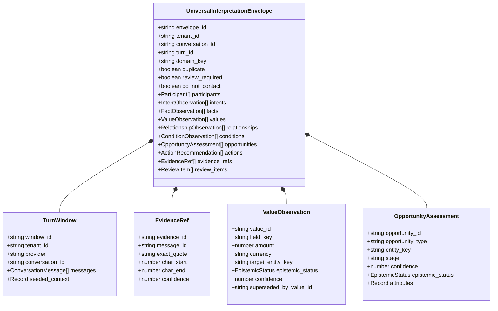

# Universal Semantic Envelope & Core Types

The Universal Core defines the foundational domain-agnostic semantic contracts in ZapTrail. All conversational inputs, deterministic extractions, LLM interpretations, and downstream CRM mutations flow through these canonical types.

## Core Schema Hierarchy

## Epistemic Status Lifecycle

Every extracted fact, value, condition, and opportunity carries an `EpistemicStatus`:
- `declared`: Directly stated by a participant in the conversation with verbatim evidence quote.
- `inferred`: Deduced by Stage 1 deterministic rules or Stage 2 LLM inference.
- `validated_external`: Confirmed against an external authority (such as an external CRM record, cadastral query, or registry).
- `validated_human`: Approved or amended by an operator in the Review Inbox (`/review`).
- `superseded`: Replaced by a more recent declaration in the conversation (e.g. price lowered from 2M to 1.85M).
- `rejected`: Marked invalid by human review or contradiction rules.

## Anti-Hallucination & Evidence Anchoring

ZapTrail enforces deterministic grounding via `quote-validator`:
1. Every `EvidenceRef` must match verbatim text in the corresponding `ConversationMessage.raw_text`.
2. Any extraction generated by an LLM that fails substring matching against the source turn is automatically flagged or discarded.
3. Review items track the exact provenance (`message_id`, `char_start`, `char_end`) to render visual highlights in the UI.
