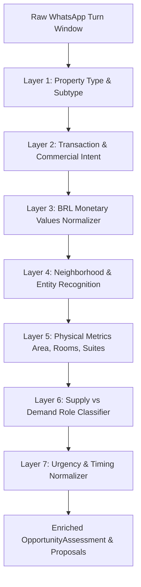

# Real Estate Domain Pack & 7-Layer Classifier

The Real Estate Domain Pack (`src/packages/domain-real-estate/`) provides domain-specific parsing, normalization, and orchestration for the real estate market. It translates unstructured Brazilian Portuguese messages into structured property assets and qualified customer profiles.

## The 7-Layer Deterministic Pipeline



### Layer 1: Property Type and Subtype
- Detects core categories: `apartment`, `house`, `commercial`, `land`, `other`.
- Distinguishes high-value subtypes: `cobertura`, `duplex`, `triplex`, `studio`, `loft`, `kitnet`, `sobrado`, `galpão`, `sala comercial`.

### Layer 2: Transaction Intent
- Discovers user intent through regex patterns in `role-intent-rules.ts`:
  - `intent.capture_for_sale` (owner selling).
  - `intent.capture_for_rent` (owner renting).
  - `intent.capture_for_sale_and_rent` (simultaneous sale and rent).
  - `intent.buy_demand` (buyer seeking purchase).
  - `intent.rent_demand` (tenant seeking rental).
  - `intent.do_not_contact` (opt-out).

### Layer 3: BRL Monetary Normalization (`normalizer-ptbr.ts`)
- Robust parsing of colloquial Brazilian monetary expressions:
  - Millions: `"1,5 milhão"`, `"2 milhões"`, `"1.8 mi"` $\rightarrow$ integer BRL cents/units.
  - Thousands with `k`: `"4.5k de aluguel"` $\rightarrow$ `4500`.
  - Thousands with `mil`: `"950 mil"` $\rightarrow$ `950000`.
  - Standard currency: `"R$ 2.500.000"`, `"por 4.500"`.
  - Distinguishes `sale_asking_price`, `rent_asking_price`, `condo_fee`, `iptu_amount`, and buyer `budget_max`.

### Layer 4: Neighborhood Recognition
- Normalizes Brazilian neighborhood names with accent-insensitive handling (e.g. `Batel`, `Leblon`, `Pinheiros`, `Moema`, `Jardins`, `Vila Madalena`).

### Layer 5: Physical Metrics
- Extracts metric numbers:
  - Bedrooms: `"3 quartos"`, `"3 dormitórios"`, `"2 dorms"`, `"4 qts"`.
  - Area: `"120m2"`, `"120 m²"`, `"120 metros quadrados"`.
  - Parking spots: `"2 vagas"`.

### Layer 6: Supply vs. Demand (`side`)
- Resolves the core commercial relationship:
  - `CAPTACAO` (Supply / Proprietário / Venda ou Locação).
  - `DEMANDA` (Buyer or Tenant / Demanda ativa).

### Layer 7: Urgency & Timing
- Resolves temporal readiness:
  - `immediate` (e.g. `"urgente"`, `"o quanto antes"`).
  - `short_term` (e.g. `"mês que vem"`, `"próximas semanas"`).
  - `flexible` (default).

## Opportunity Attributes Builder (`opportunity-attributes-builder.ts`)
Synthesizes the extracted 7 layers into structured `OpportunityAssessment.attributes`:
```json
{
  "side": "CAPTACAO",
  "intention": "venda",
  "targetValue": "1800000",
  "neighborhood": "Pinheiros",
  "timing": "immediate",
  "propertyDraft": {
    "type": "apartment",
    "price": 1800000,
    "neighborhood": "Pinheiros",
    "rooms": 3,
    "area_sqm": 120
  }
}
```
