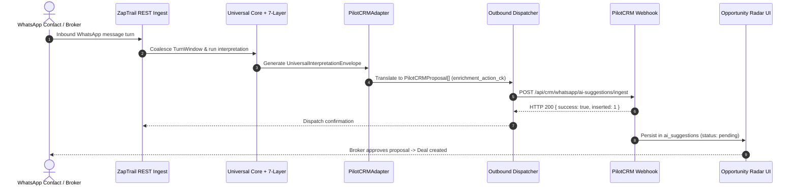

# PilotCRM Hexagonal Adapter & AI Suggestions Loop

ZapTrail connects to PilotCRM via a decoupled hexagonal adapter pattern. Rather than writing directly to PilotCRM's internal relational tables, ZapTrail acts as an autonomous intelligence provider, converting conversation turns into standardized proposal contracts dispatched over webhooks.

## The Closed-Loop Integration Workflow

## The PilotCRM Proposal Contract (`PilotCRMAdapter`)

PilotCRM enforces a database check constraint called `enrichment_action_ck`. The `PilotCRMAdapter` strictly translates universal envelope events into valid action types:

| Universal Event | Enrichment Action | Target Entity | PilotCRM Payload Effect |
| :--- | :--- | :--- | :--- |
| **New Opportunity (Sale/Buy/Rent)** | `ADD` | `deal` | Populates `side`, `intention`, `targetValue`, `neighborhood`, `timing`, and `propertyDraft`. |
| **Price Adjustment / Correction** | `UPDATE` | `property` | Populates `field_key`, `amount`, and `superseded_value_id`. |
| **Explicit Opt-out ("Não me mande msg")** | `SUPPRESS` | `contact` | Signals immediate suppression of commercial outreach. |
| **Ambiguous / Contradictory Information** | `REVIEW` | `deal` or `conversation` | Sets `requires_human_review: true` with review reasons. |
| **Conditional Transaction ("Vender antes")** | `RELATE` | `relationship` | Links dependent opportunities together. |
| **Future Interest / Nurture** | `DEFER` | `deal` | Recommends registering future follow-up. |

## Outbound Webhook Security & Reliability

The outbound dispatcher (`src/packages/api/outbound-dispatcher.ts`) implements production hardening:
1. **Starvation Timeout:** Uses `AbortSignal.timeout(8000)` to ensure network latency or remote CRM hangs cannot block ZapTrail workers.
2. **Credential Redaction:** Token masking functions guarantee that Bearer tokens and webhook secrets are never logged in plaintext error traces.
3. **Multi-Tenant Isolation:** Propagates `x-zaptrail-tenant-id` header to enforce strict multi-tenant boundary compliance.
4. **Idempotency Guard:** If an envelope is flagged as `duplicate: true`, the dispatcher suppresses HTTP traffic, preventing duplicate proposals.
