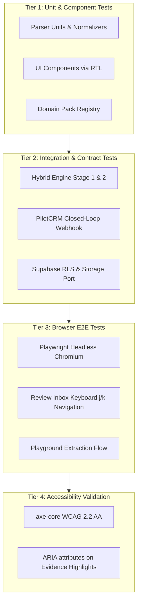

# Testing Strategy & Quality Gates

ZapTrail enforces a strict engineering quality harness. No code reaches production without passing through four tiers of automated verification and architectural boundary linting.

## Quality Gates (`scripts/check-quality-gates.mjs`)

Every production file must satisfy the automated quality gates script before commits are authorized:

```bash
node scripts/check-quality-gates.mjs
```

### The 4 Non-Negotiable Rules:
1. **The 350-Line Ceiling (`quality/max-lines`):** Every production `.ts` and `.tsx` file must be $\le 350$ lines of code. Barrel files and pure type definitions are the only exemptions.
2. **Design System Token Integrity:** Direct or raw Tailwind palette colors (such as `bg-blue-500` or `#3b82f6`) are prohibited. All styles must use PilotCRM semantic OKLCH tokens (`primary`, `muted`, `background`, `border`, `card`, `warning`, `destructive`, `success`).
3. **Scrim & Opacity Contract:** Modals, sheets, and dialogs must implement standardized backdrop scrim values (`bg-black/50`, `backdrop-blur-sm`).
4. **The 6 Laws of UI Writing:** User-facing strings must adhere to clean Brazilian Portuguese, avoiding raw system jargon (e.g. replacing `"Payload editado"` with `"Dados extraídos editados"`).

## Multi-Tier Testing Architecture



### 1. Vitest Unit & Integration Suites
Over 41 test suites covering core interpretation, 7-layer classifiers, quote validation, and REST route handlers.
```bash
npx vitest run
```

### 2. PilotCRM Closed-Loop Integration Test
Validates that WhatsApp conversation turns flow through turn coalescing, the 7-layer classifier, the PilotCRM adapter, and outbound dispatch matching PilotCRM's exact Zod ingestion schema (`tests/integration/pilotcrm-closed-loop.test.ts`).

### 3. Playwright E2E Tests
Runs automated browser sessions using real Chromium instances against an isolated Next.js production build:
```bash
npx playwright test
```
Tests cover:
- Review Inbox table rendering and item selection.
- Global Command Palette (`Ctrl+K`) filtering and keyboard navigation.
- Playground real-time conversation extraction and link transitions.

## Zero-Cost CI Gateway (`scripts/ci-gateway.mjs`)

To prevent exhaustion of free GitHub Actions billing quotas (2,000 minutes/month), ZapTrail adopts the **CI Gateway** pattern identical to PilotCRM:
- **`CI_MODE=full` (default):** Runs quality gates, TypeScript checks, Vitest test suites, and Next.js builds on push/PR.
- **`CI_MODE=standby`:** Automatically skips all jobs (`skipped` status, 0 minutes consumed).
- **Manual Overrides:** Any run can be manually triggered via `workflow_dispatch` with `force_run=true` or `run_e2e=true`.

```bash
# Check current CI mode and billing status
pnpm ci:check

# Activate standby mode (save quota)
pnpm ci:standby

# Re-activate full mode
pnpm ci:full

# Auto-detect billing blockage and toggle
pnpm ci:auto
```

