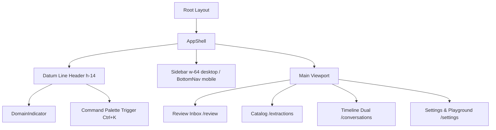

# PilotCRM Design System & UI Components

ZapTrail features a high-density, accessible frontend designed to match PilotCRM's native design system (`@repo/ui`). The interface is built with Next.js 16 App Router, React 19, Tailwind CSS, Radix UI primitives, and Vaul drawers.

## OKLCH Semantic Color System

ZapTrail avoids arbitrary hex or raw Tailwind colors. All styles consume OKLCH semantic tokens defined in `src/app/globals.css`:

```css
:root {
  --background: oklch(0.985 0 0);
  --foreground: oklch(0.145 0 0);
  --card: oklch(1 0 0);
  --card-foreground: oklch(0.145 0 0);
  --primary: oklch(0.205 0 0);
  --primary-foreground: oklch(0.985 0 0);
  --muted: oklch(0.97 0 0);
  --muted-foreground: oklch(0.556 0 0);
  --border: oklch(0.922 0 0);
  --warning: oklch(0.769 0.188 70.08);
  --destructive: oklch(0.577 0.245 27.325);
  --success: oklch(0.627 0.194 149.214);
}
```

## AppShell & Navigation Architecture



### 1. Header Datum Line (`h-14`)
Standardized horizontal datum line providing consistent alignment, current workspace context, active domain indicator, and global Command Palette trigger.

### 2. Review Inbox (`/review`)
The operational core of the platform for human-in-the-loop oversight:
- **DataTable:** Sortable items prioritized by severity (`critical`, `warning`, `info`).
- **Peek Sheet:** Drawer/sheet sliding from the right to inspect context without losing table position.
- **Evidence Highlighting:** Renders verbatim source quotes in `<mark>` elements styled with `bg-warning/20 font-semibold` and accessible labels.
- **Keyboard Navigation:** Operates entirely without a mouse (`j`/`k` for item navigation, `Enter` to approve, `e` to edit, `r` to reject).

### 3. Playground (`/settings/playground`)
Interactive dual-pane test environment allowing engineers and operators to paste conversational turns, select a domain pack, and observe real-time 7-layer extraction with sub-second feedback.

## Accessibility Standards (WCAG 2.2 AA)
- **Keyboard Traps Eliminated:** All modal dialogs, sheets, and menus trap focus appropriately and close cleanly with `Escape`.
- **Focus Rings:** Every interactive element provides high-contrast focus rings (`focus-visible:ring-2 focus-visible:ring-ring`).
- **Target Sizes:** Touch targets meet the minimum $44 \times 44$ pixel standard (`min-h-11 min-w-11`) on mobile viewports.
