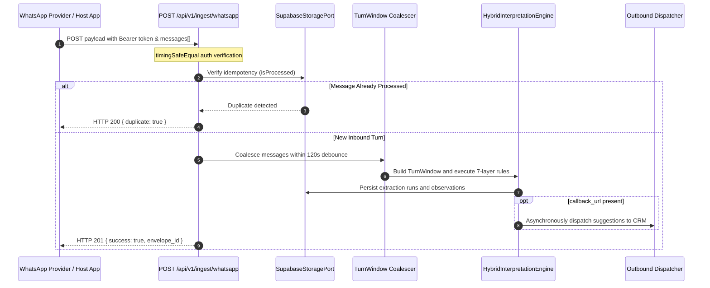

# WhatsApp Turn Ingestion Pipeline & Coalescing

The WhatsApp Ingestion Pipeline processes real-world asynchronous messaging traffic from WhatsApp business integrations. It handles message bursts, token authentication, idempotency deduplication, and automated outbound webhook notifications.

## Ingestion Architecture

## Security & Authentication

The endpoint validates inbound requests in `src/app/api/v1/ingest/whatsapp/route.ts`:
- If `ZAPTRAIL_API_TOKEN` is configured, requests must supply `Authorization: Bearer <token>`.
- Token comparison uses `timingSafeEqual` from Node's `crypto` module to protect against side-channel timing attacks.
- Missing or invalid tokens immediately reject with HTTP 401 Unauthorized.

## WhatsApp Message Coalescing (`turn-window-coalescer.ts`)

In messaging platforms, users frequently split thoughts into short, consecutive messages:
> *"Olá"*  
> *"Tenho um apto no Leblon"*  
> *"3 quartos, quero 2.5 mi"*

The Turn Coalescer solves this by:
1. Grouping consecutive inbound messages within a **120-second debounce window** into a single `TurnWindow`.
2. Preserving individual message IDs and character offsets for precise evidence attribution.
3. Normalizing Brazilian Portuguese text (converting unicode variants, handling spacing around currency symbols).
4. Binding existing seeded properties (`seeded_property_candidates`) from prior CRM context.

## Idempotency Protocol

To prevent duplicate webhook processing caused by network retries:
- The storage port tracks `(tenant_id, provider, external_message_id)`.
- If an incoming payload contains only previously processed message IDs, ZapTrail returns HTTP 200 with the cached envelope and sets `duplicate: true`.
- When an envelope is marked duplicate, outbound webhook dispatches are skipped.
